# SELENORA
### Science-Driven Lunar Landing Decisions

**Where you land matters. When you land matters just as much.**

[](LICENSE)
`SPDX-License-Identifier: Apache-2.0`

NASA Space Apps Challenge 2026 · [Lunar Landing Site Navigator](https://www.spaceappschallenge.org/2026/challenges/lunar-landing-site-navigator/)

SELENORA is an interactive lunar landing-site decision-support platform that turns NASA and JPL data into accessible, scientifically transparent mission insights. Explore south-polar candidate locations on a real NASA globe, compare sunlight and direct-to-Earth geometry, inspect operational windows and relative solar opportunity, test alternative mission dates, visualise multi-resolution LOLA terrain, and place verified Apollo/CLPS history beside your research sites — with uncertainty labelled instead of hidden.

This is a research and education prototype. It is **not** a flight-certified landing-safety or mission-operations system, and it is **not** endorsed by NASA or JPL.

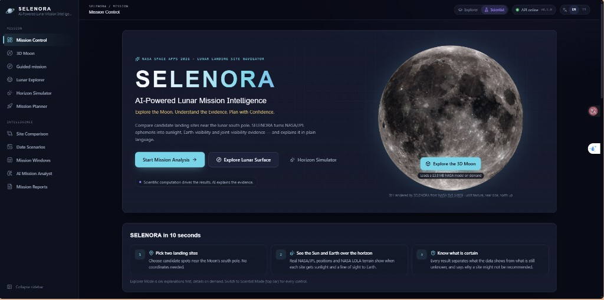

| Explore | Analyze | Compare | Decide |
| --- | --- | --- | --- |
| 3D Moon, Lunar Explorer, Guided Mission, optional Apollo/CLPS history | Horizons + geometric or local LOLA horizons, windows, events, solar potential | Sites, dates and panel geometries with provenance | Weighted deterministic scoring — refuse a winner when evidence is incomplete |

---

## The Challenge — Why Lunar Landing Is Difficult

Near the lunar south pole, the Sun stays low. Crater rims and ridges can throw long shadows for days. A site that looks bright in a static photograph may sit in darkness for a chosen mission window — or lose Earth above the horizon when a crew or lander most needs a direct line of sight.

Power and communication are therefore **time-dependent**. Choosing a place without choosing dates is incomplete. Terrain coverage is also incomplete — if elevation data does not cover a ray, that gap must stay visible as uncertainty, not as clear sky.

SELENORA makes those trade-offs inspectable with open NASA data.

---

## Our Solution — How SELENORA Works

```text
Explore → Choose sites → Select dates → Analyze Sun/Earth visibility
      → Compare windows, solar potential & date scenarios
      → Examine uncertainty → Make an informed research decision
```

1. **Explore** — Mission Control, 3D Moon (with optional Lunar Missions history), Lunar Explorer and Horizon Simulator.
2. **Configure** — Guided Mission or Mission Planner sets sites, UTC window, sample step, horizon model and priority weights.
3. **Compute** — FastAPI fetches NASA/JPL Horizons tables, applies geometric or local LOLA terrain horizons, and stores provenance.
4. **Interpret** — Comparison, Windows, relative solar potential and Date Scenarios present evidence without inventing missing values.
5. **Explain (optional)** — AI Mission Analyst narrates a stored evidence package; it never recalculates orbital geometry or rankings.

---

## Interactive Features

### Mission Control
Entry dashboard for the challenge journey (hero screenshot above).

### 3D Moon
Interactive globe from [NASA SVS 14959](https://svs.gsfc.nasa.gov/14959/) (Standard / High when local assets are present). Research-site markers and custom points are navigation aids — Sun, Earth and terrain science still come from the validated engines.

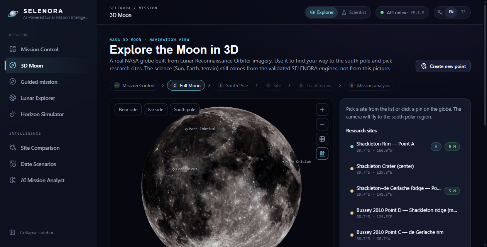

### Lunar Missions layer (Phase 7E)
Optional Apollo and CLPS history on the global 3D Moon. Verified coordinates only — **not** research-site scoring. Filter by program and outcome: Successful, Partial, Unsuccessful, Aborted, Planned. Planned/failed targets use region rings or list-only entries when exact pins are not scientifically defensible.

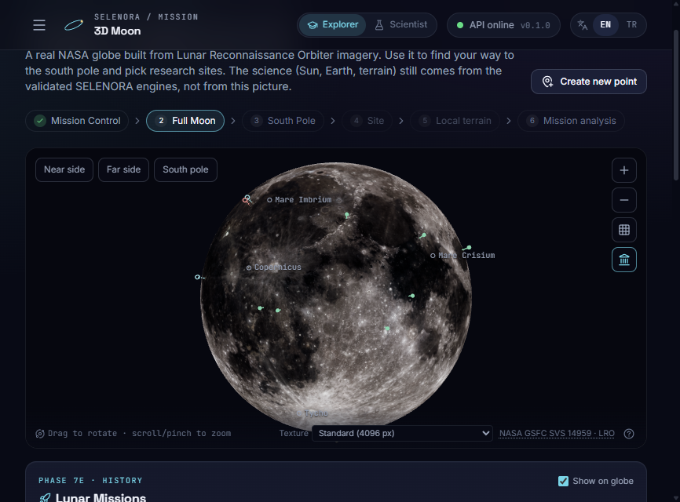

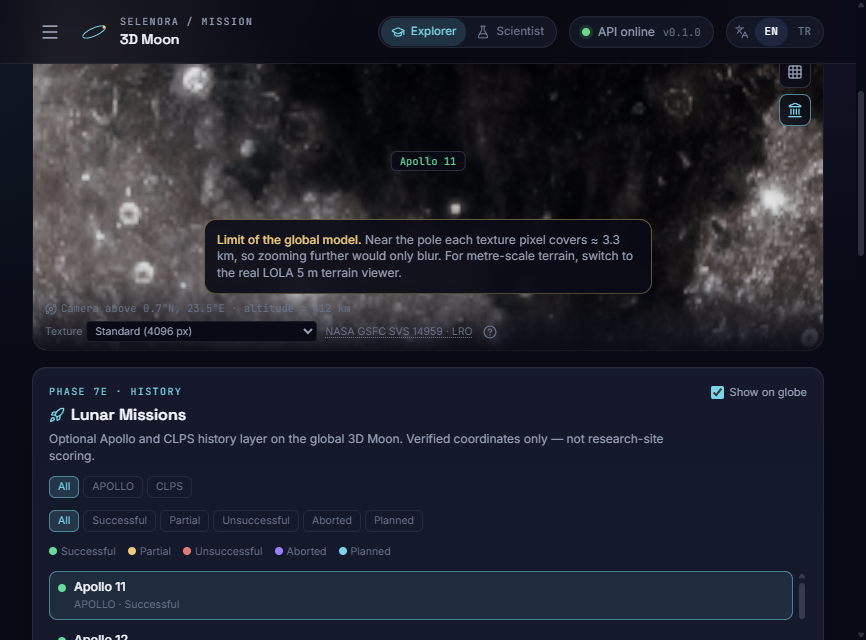

### Lunar Explorer
South-polar stereographic map with LROC WAC photography, LOLA tile footprints and elevation sampling. Science DEMs and visualization-only layers are labelled separately.

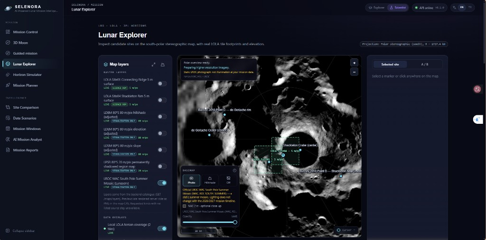

### Horizon Simulator & multi-resolution DEM (Phase 7D)
Step through stored epochs for Sun/Earth against the geometric 0° horizon or a **local Product 78** LOLA terrain silhouette. For 3D mesh visualisation, SELENORA prefers local 5 m DEMs when covered, and can fall back to remote [PGDA Product 90](https://pgda.gsfc.nasa.gov/products/90) elevation COGs (example: custom point near **88.5° S, 0° E** at native **40 m**, `REMOTE_PGDA90`).

**Critical limit:** remote DEM fallback supports **3D visualization and provenance only**. It does **not** extend the validated TERRAIN horizon / scoring engine. Outside local 5 m tiles, horizon requests remain `TERRAIN_UNAVAILABLE` rather than inventing a clear sky.


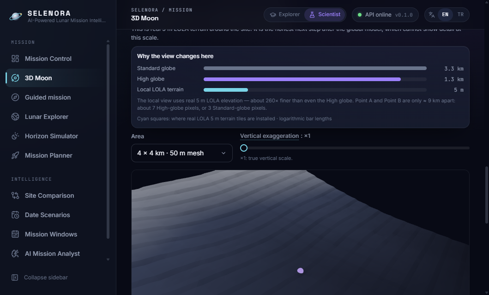

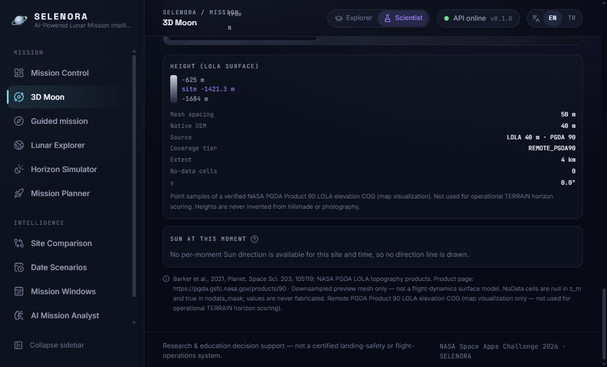

### Mission Planner
Sites A/B, UTC bounds, resolution, `GEOMETRIC` or `TERRAIN` horizon, and weighted priorities. Run live Horizons analysis or a labelled `SYNTHETIC_DEMO` preview.


### Site Comparison
Sunlight, Earth visibility, joint visibility, longest darkness and communication-gap metrics with deterministic recommendations when evidence is scorable — not AI rankings.


### Mission Windows & Operational Events (Phase 7A)
Hourly visibility heatmaps and operational events from sampled epochs. Cells may be visible, not visible, unknown, or empty.

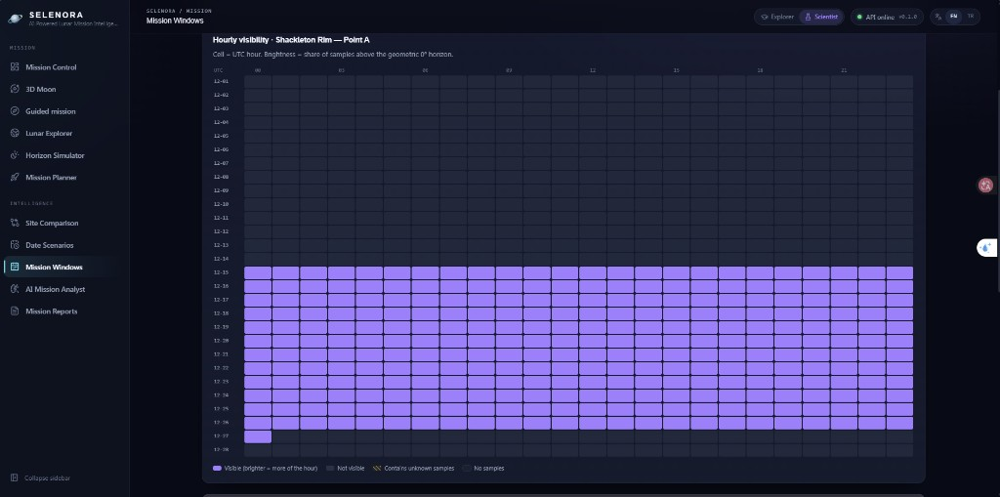

### Relative Solar Potential (Phase 7B)
Compares horizontal, fixed, azimuth-tracking and dual-axis illumination geometry. **Not** watts or kWh. Near-ties within 0.5 percentage points are not distinguishable.


### Alternative Mission Dates (Phase 7C)
One stable site across independent UTC windows (e.g. December 2026 vs January 2027), each with its own ephemeris and provenance.

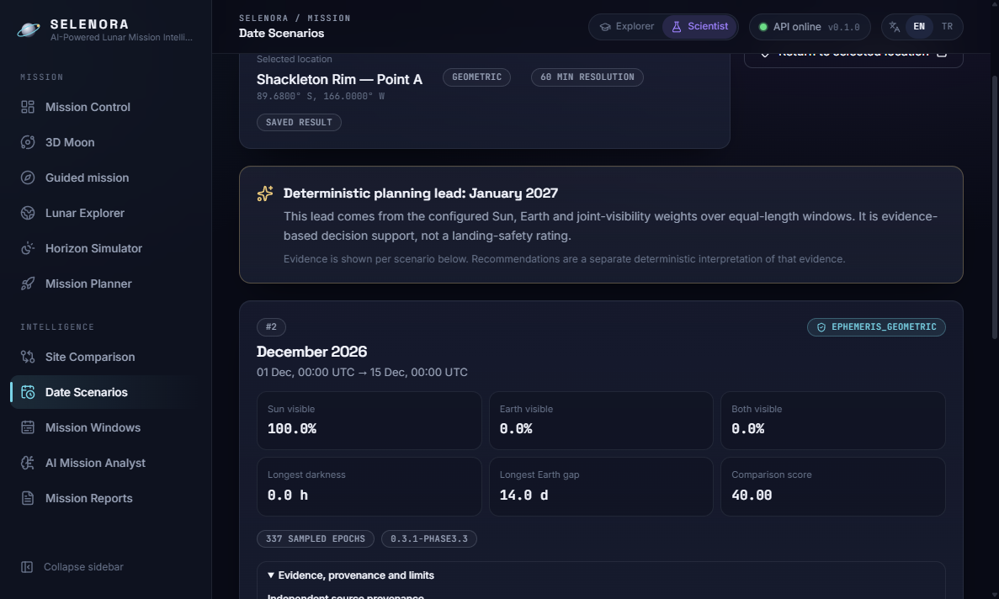

### Guided Mission, AI Analyst & Reports
| Capability | What it does |
| --- | --- |
| Guided Mission | Four short steps with educational weight presets. |
| AI Mission Analyst | Optional DeepSeek briefing over an allow-listed evidence package; number/ranking guards; disabled without `DEEPSEEK_API_KEY`. |
| Mission Reports | Stored analyses, provenance, limitations and AI summary when present. |
| EN / TR · responsive | Full bilingual UI with mobile-usable routes. |

---

## Real NASA Data & Scientific Method

| Source | Role in SELENORA | Official entry points |
| --- | --- | --- |
| **NASA/JPL Horizons** | Sun (`COMMAND=10`) and Earth (`COMMAND=399`) apparent Az/El at lunar GEODETIC sites (`CENTER=coord@301`) | [Horizons API](https://ssd-api.jpl.nasa.gov/doc/horizons.html) · [SSD Horizons](https://ssd.jpl.nasa.gov/horizons/) |
| **PGDA Product 78** | Local Site01/Site04 **5 m** LOLA DEMs for validated terrain horizons + preferred mesh | [Product 78](https://pgda.gsfc.nasa.gov/products/78) |
| **PGDA Product 90** | Regional LOLA elevation COGs for **remote mesh visualisation** fallback | [Product 90](https://pgda.gsfc.nasa.gov/products/90) |
| **LOLA science citation** | Barker et al., 2021, *Planet. Space Sci.* 203, 105119 | [DOI](https://doi.org/10.1016/j.pss.2020.105119) |
| **NASA LROC WAC** | South Pole Summer Mosaic (photographic context) | [WAC_ROI_SOUTH_SUMMER](https://data.lroc.im-ldi.com/lroc/view_rdr/WAC_ROI_SOUTH_SUMMER) |
| **NASA SVS 14959** | Interactive 3D Moon GLB models | [SVS 14959](https://svs.gsfc.nasa.gov/14959/) |
| **NSSDC / LROC / CLPS / IAU** | Optional Lunar Missions catalog coordinates and region centroids | [NSSDC lunar sites](https://nssdc.gsfc.nasa.gov/planetary/lunar/lunar_sites.html) · [NASA CLPS](https://science.nasa.gov/lunar-science/clps-deliveries/) |

**Coordinate convention:** planetocentric latitude, east-positive longitude, lunar Mean-Earth / polar-axis body-fixed frame as reported by Horizons. Reference radius 1737.4 km. Seed research sites are `APPROXIMATE_REFERENCE`, not Artemis III polygons. Mission-catalog pins store source frame labels; SELENORA does not invent ME↔PA remapping.

Photographs, elevation rasters, ephemerides and history markers are separate products. A bright crater wall in LROC imagery does not prove sunlight during your UTC window.

---

## Scientific Integrity — Our Key Differentiator

**A trustworthy decision-support tool must know when the data is not enough.**

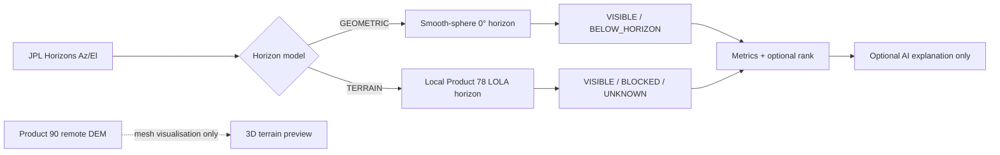

| Principle | Meaning in SELENORA |
| --- | --- |
| **VISIBLE / BLOCKED / UNKNOWN** | Missing DEM coverage is never clear sky. UNKNOWN ≠ darkness. |
| **GEOMETRIC ≠ TERRAIN** | Smooth-sphere vs local LOLA evidence, labelled in every result. |
| **Remote DEM ≠ horizon science** | Product 90 mesh fallback does not feed TERRAIN scoring. |
| **Missions ≠ candidate scoring** | Apollo/CLPS layer is historical context only. |
| **Relative solar ≠ power** | Illumination geometry only — no W / kWh claims. |
| **Conditional rankings** | Ties and incomplete evidence produce no forced winner. |
| **AI does not compute science** | Explains stored evidence; cannot override ranks. |

---

## Technical Architecture

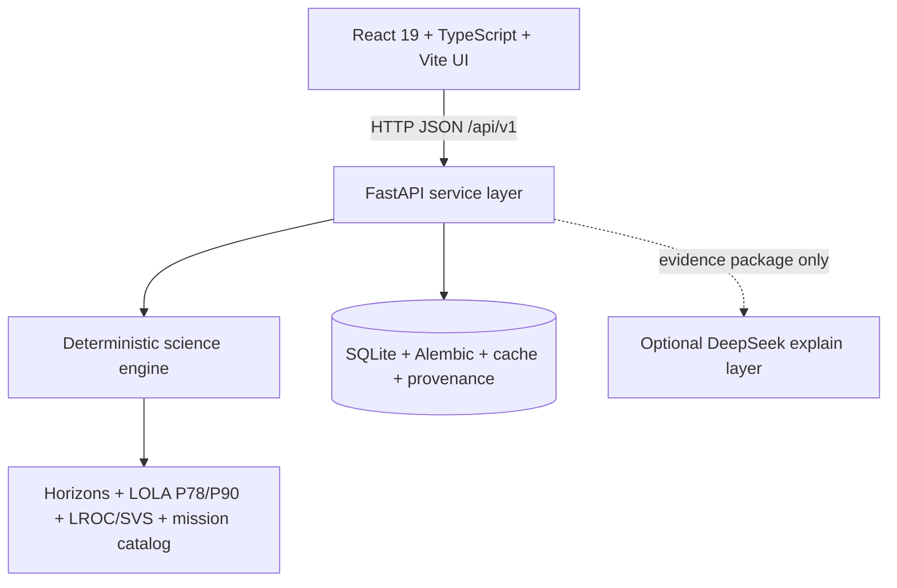

| Layer | Stack |
| --- | --- |
| Frontend | React 19, TypeScript, Vite, Tailwind v4, OpenLayers, R3F, i18next, TanStack Query, Zustand |
| Backend | FastAPI, Pydantic Settings, SQLAlchemy 2, Alembic, NumPy, httpx, rasterio |
| Persistence | SQLite default; migrations through Phase 7C `scenario_comparisons` |
| APIs of note | analyses, events, solar-potential, scenarios, terrain, maps/mesh, missions, explain |

Algorithm stamps: geometric `0.3.1-phase3.3` · terrain `0.4.2-phase6c-science-h1`.

---

## Example Scientific Workflow

1. **Mission Planner** — Shackleton-region sites, December 2026 / January 2027 class windows, 60 min step, weights e.g. 40/40/20.
2. **Site Comparison** — sunlight vs Earth-visibility trade-offs; confirm quality badge.
3. **Mission Windows** — when visibility concentrates inside the sampled month.
4. **Relative solar potential** — panel geometries without treating indices as electrical power.
5. **Date Scenarios** — same coordinates, independent UTC windows and provenance.
6. **Horizon / DEM** — local 5 m mesh where covered; remote Product 90 mesh for exploration outside tiles (not TERRAIN scoring).
7. **Lunar Missions** — optional Apollo/CLPS context on the globe; keep it separate from candidate rankings.
8. **Mission Reports / AI Analyst** — audit provenance; optional plain-language briefing.

---

## Installation & Local Development

**Prerequisites:** Python **3.12+**, Node.js **20+** (reports also cite Node 24.x), Git. LOLA GeoTIFFs and SVS GLBs are **not** in Git.

### Backend

```powershell
cd backend
python -m venv .venv
.\.venv\Scripts\Activate.ps1
pip install -e ".[dev]"
Copy-Item .env.example .env
# Optional: DEEPSEEK_API_KEY for AI briefings only
uvicorn app.main:app --reload --host 127.0.0.1 --port 8000
```

API docs: http://127.0.0.1:8000/docs · Health: http://127.0.0.1:8000/health  
Startup runs DB init and Alembic `upgrade head`.

### Frontend

```powershell
cd frontend
npm install
npm run dev
```

Open http://localhost:5173 (`$env:SELENORA_BACKEND_URL` overrides the proxy target).

### One-click Windows launcher

`start-selenora.bat` prepares polar overview caches when possible, then starts backend `:8000` and frontend `:5173`.

### Optional NASA data (gitignored)

| Asset | Needed for |
| --- | --- |
| LOLA Site01/Site04 under `data/raw/lola/` | `TERRAIN` horizons + preferred 5 m mesh |
| SVS 14959 GLBs (`npm run fetch:moon`) | Standard / High 3D Moon |
| Network access to PGDA Product 90 COGs | Remote mesh fallback outside local tiles |
| Polar overview pyramid | Fast Explorer basemap (`prepare_polar_overviews`) |

**Never commit `.env` or API keys.** Live Horizons and DeepSeek need the network; stored analyses and local rasters support offline inspection.

### Tests

```powershell
cd backend
.\.venv\Scripts\python.exe -m pytest
.\.venv\Scripts\python.exe -m pytest -m live -o addopts=""

cd frontend
npx tsc -b
npx vitest run
npm run build
```

---

## Testing & Validation

Verified on the final submission integration now on `origin/main` (`32a7a20`, PR #8), per [`docs/SELENORA_SUBMISSION_INTEGRATION_REPORT.md`](docs/SELENORA_SUBMISSION_INTEGRATION_REPORT.md):

| Gate | Result |
| --- | --- |
| Backend pytest | **292 passed**, 1 skipped |
| Frontend Vitest | **219 passed** |
| `tsc -b` / `vite build` / oxlint | Pass |
| Live remote DEM mesh | Product 90 @ −88.5°, 0° |
| Browser QA | Missions layer, Apollo 11, DEM provenance, 7C scenarios, TR/EN, mobile |

---

## Scientific Limitations

- Local 5 m Product 78 tiles cover only small south-polar boxes; most lon/lat cannot use TERRAIN mode.
- Remote Product 90 meshes are visualisation fallbacks — not horizon/scoring inputs.
- Ephemeris events inherit sample-and-hold uncertainty (± one step).
- Seed sites and planned-mission region rings are approximate; planned targets are not confirmed landing locations.
- Earth above the horizon ≠ link budget / DSN schedule.
- Relative solar potential ≠ electrical power.
- Static LROC mosaics ≠ mission-date illumination.
- Optional AI briefings require a configured key and never invent scientific numbers.
- SELENORA does not certify landing safety or flight operations.

---

## Roadmap / Release status

### Released on `main` (Phases 7A–7E)
- Mission Control, 3D Moon, Guided Mission, Lunar Explorer, Horizon Simulator, Mission Planner  
- Site Comparison, Mission Windows / events, Relative Solar Potential, Date Scenarios  
- Multi-resolution DEM mesh fallback (7D) with local P78 vs remote P90 provenance  
- Apollo/CLPS Lunar Missions layer (7E)  
- Optional AI Mission Analyst and Mission Reports · EN/TR · responsive UI  

### Future (not claimed here)
Broader DEM horizon science, expanded catalogs, and deployment packaging may continue after the Space Apps submission window.

---

## Team, Credits & AI Disclosure

- **Project / Team:** SELENORA  
- **Challenge:** NASA Space Apps Challenge 2026 — Lunar Landing Site Navigator  
- **Repository:** [seyyitkse/Nasa-Space-Apps-SELENORA-Projesi](https://github.com/seyyitkse/Nasa-Space-Apps-SELENORA-Projesi)

| Role | Name |
| --- | --- |
| Team Leader | Ahmet Seyyit KÖSE |
| Team Member | Nursena ÇAMKÖMÜRÜ |

**AI-assisted development:** Implementation, review and documentation used AI coding tools (including Cursor, Claude, Codex and ZCode workflows). Scientific computations use deterministic code and verified NASA/JPL inputs — not fabricated model outputs. The optional DeepSeek layer only explains stored evidence packages.

---

## License, Sources & Acknowledgments

**License:** [Apache License, Version 2.0](LICENSE) (`SPDX-License-Identifier: Apache-2.0`).  
Apache-2.0 covers SELENORA’s original software and project documentation as distributed in this repository. It does **not** relicense NASA imagery, LOLA/LROC/SVS assets, Horizons data, mission-coordinate source products, or third-party libraries and AI services. See [NOTICE](NOTICE) for attribution boundaries.

**Primary acknowledgments**
- NASA / JPL Horizons (Solar System Dynamics)
- NASA GSFC PGDA LOLA Products 78 and 90; Barker et al. (2021)
- NASA / GSFC / ASU — LROC WAC South Pole Summer Mosaic
- NASA GSFC SVS 14959 Moon models
- NASA NSSDC, LROC and CLPS references used by the optional missions catalog

**Further documentation**
- [Architecture](docs/ARCHITECTURE.md) · [API contract](docs/API_CONTRACT.md) · [Data sources](docs/DATA_SOURCES.md)
- [Submission integration report](docs/SELENORA_SUBMISSION_INTEGRATION_REPORT.md)
- [Phase 7D MVP](docs/PHASE7D_MVP_REPORT.md) · [Phase 7E MVP](docs/PHASE7E_MVP_REPORT.md)
- [Phase 7A](docs/PHASE7A_UNIFIED_INTEGRATION_REPORT.md) · [Phase 7B](docs/PHASE7B_COMPLETION_REPORT.md) · [Phase 7C](docs/PHASE7C_IMPLEMENTATION_REPORT.md)

SELENORA is an independent student / competition project. NASA, JPL, LROC, PGDA, NSSDC and DeepSeek names appear for attribution and interoperability only.
