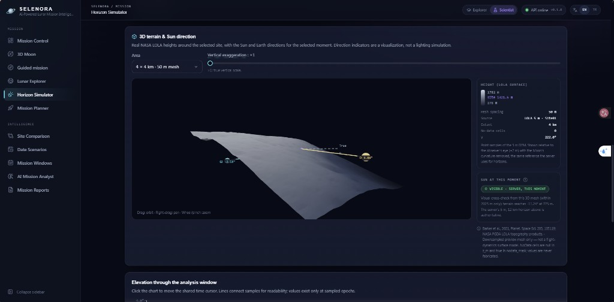
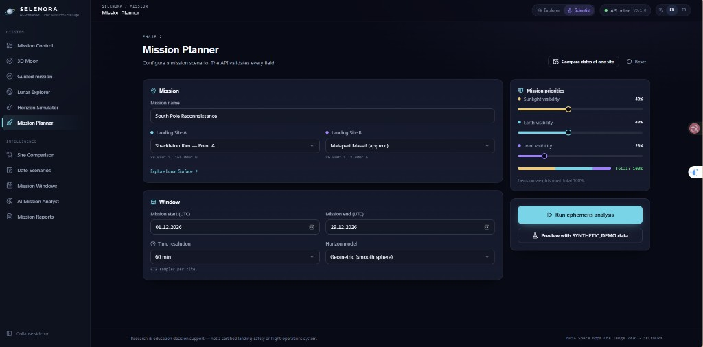
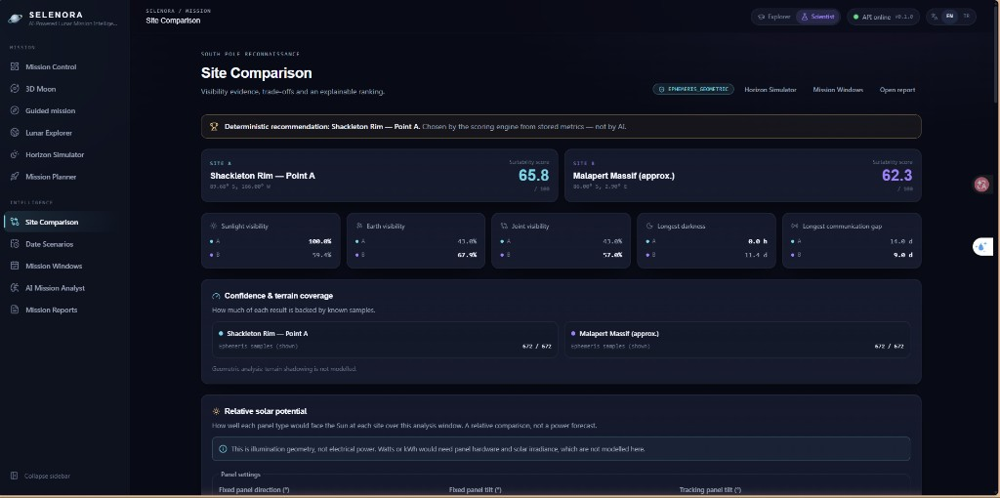
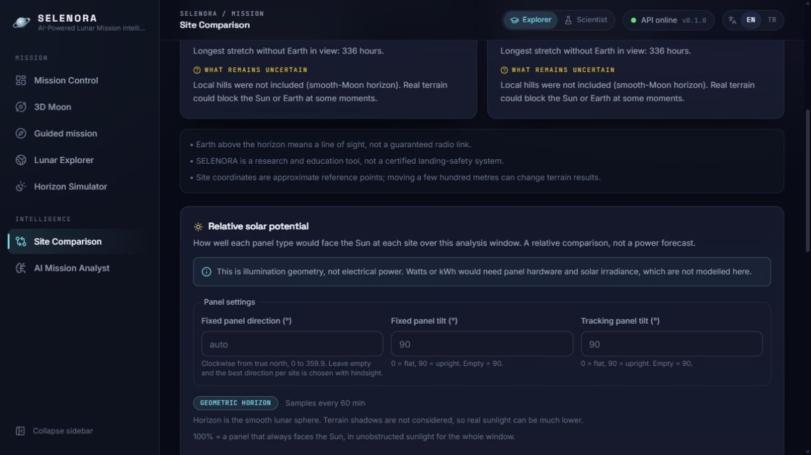
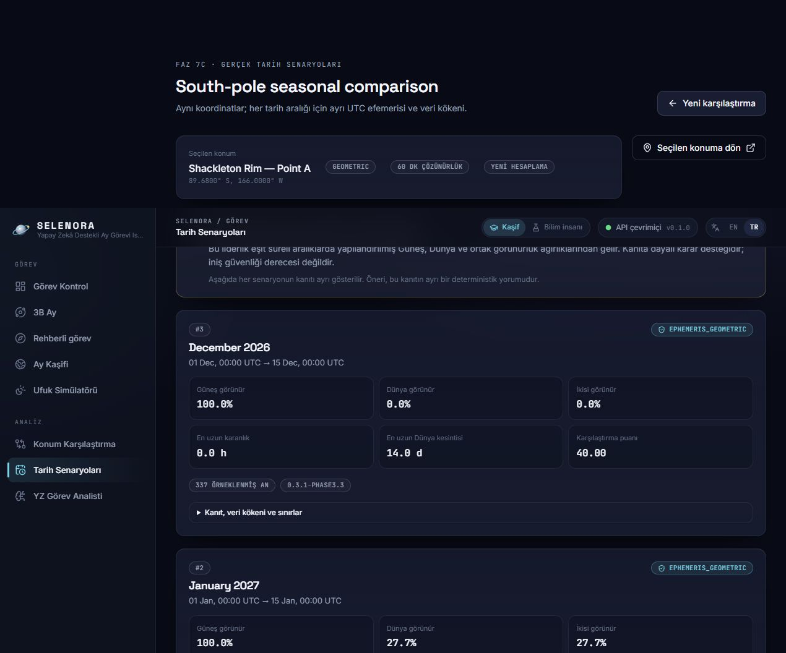
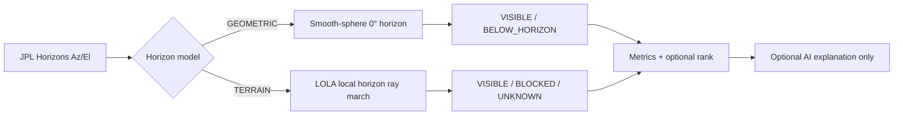
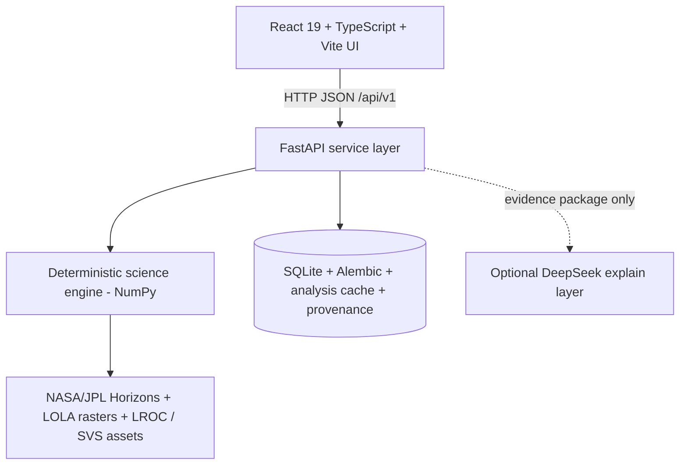

# SELENORA
### Science-Driven Lunar Landing Decisions

**Where you land matters. When you land matters just as much.**

NASA Space Apps Challenge 2026 · [Lunar Landing Site Navigator](https://www.spaceappschallenge.org/2026/challenges/lunar-landing-site-navigator/)

SELENORA is an interactive lunar landing-site decision-support platform that turns NASA and JPL data into accessible, scientifically transparent mission insights. Explore south-polar candidate locations, compare sunlight and direct-to-Earth geometry, inspect operational windows, and see how alternative mission dates change the picture — with uncertainty labelled instead of hidden.

This is a research and education prototype. It is **not** a flight-certified landing-safety or mission-operations system, and it is **not** endorsed by NASA or JPL.


| Explore | Analyze | Decide |
| --- | --- | --- |
| Walk the Moon in 3D, inspect south-polar imagery, and pick candidate sites — including custom points. | Run JPL Horizons ephemerides with geometric or LOLA terrain horizons; inspect events, windows and relative solar opportunity. | Compare sites and dates with weighted, deterministic scoring — and see when the evidence is incomplete. |

---

## The Challenge — Why Lunar Landing Is Difficult

Near the lunar south pole, the Sun stays low. Crater rims and ridges can throw long shadows for days. A site that looks bright in a static photograph may sit in darkness for a chosen mission window — or lose Earth above the horizon when a crew or lander most needs a direct line of sight.

Power and communication are therefore **time-dependent**. Choosing a place without choosing dates is incomplete: the same ridge can look excellent in December and far less workable a few weeks later. Terrain coverage is also incomplete — if elevation data does not cover a ray, that gap must stay visible as uncertainty, not as clear sky.

SELENORA exists to make those trade-offs inspectable for researchers, educators and challenge judges using open NASA data.

---

## Our Solution — How SELENORA Works

```text
Explore the Moon → Choose candidate sites → Select mission dates
        → Analyze Sun / Earth visibility
        → Compare windows, relative solar potential and date scenarios
        → Examine uncertainty → Make an informed research decision
```

1. **Explore** — Mission Control, 3D Moon and Lunar Explorer orient you on south-polar geography.
2. **Configure** — Guided Mission or Mission Planner sets sites, UTC window, sample step, horizon model and priority weights.
3. **Compute** — The FastAPI science engine fetches NASA/JPL Horizons observer tables, applies geometric or LOLA terrain horizons, and stores provenance.
4. **Interpret** — Site Comparison, Mission Windows, Horizon Simulator, relative solar potential and Date Scenarios present evidence without inventing missing values.
5. **Explain (optional)** — The AI Mission Analyst can narrate a stored evidence package; it never recalculates orbital geometry or rankings.

---

## Interactive Features

### Mission Control
Entry dashboard for the challenge journey: start an analysis, open the lunar surface explorer, or jump to the Horizon Simulator (hero screenshot above).

### 3D Moon
An interactive globe built from [NASA SVS 14959](https://svs.gsfc.nasa.gov/14959/) LRO-based models (Standard and High quality when the local assets are present). Markers help pick research sites; the globe is a navigation aid — Sun, Earth and terrain science still come from the validated engines, not from the picture.


### Lunar Explorer
South-polar stereographic map with LROC WAC photography, LOLA tile footprints and elevation sampling. Science DEMs and visualization-only layers are labelled separately so photographic lighting is never confused with mission-time illumination.


### Horizon Simulator
Step through stored analysis epochs to see Sun and Earth against the geometric 0° horizon or a LOLA terrain silhouette. A 3D local mesh can visualise real LOLA heights around a covered site; authoritative visibility still comes from the server horizon profile and ephemeris states.



### Mission Planner
Configure mission name, landing sites A/B, UTC start/end, time resolution, horizon model (`GEOMETRIC` or `TERRAIN`) and weighted priorities (sunlight / Earth / joint). Run a real Horizons analysis, or preview a clearly labelled `SYNTHETIC_DEMO` path for offline UI checks.



### Site Comparison
Side-by-side sunlight, Earth visibility, joint visibility, longest darkness and longest communication-gap metrics, plus a deterministic recommendation when the evidence is scorable. Rankings come from the scoring engine — not from AI.



### Mission Windows & Operational Events (Phase 7A)
Hourly visibility heatmaps and operational event lists derived from sampled epochs. Cells can show visible, not visible, unknown samples, or no samples — so missing data stays visible.


### Relative Solar Potential (Phase 7B)
Compares how horizontal, fixed, azimuth-tracking and dual-axis panel geometries would face the Sun over the analysis window. This is **illumination geometry**, not watts or kWh. Near-ties within 0.5 percentage points are reported as not distinguishable.



### Alternative Mission Dates (Phase 7C)
Keep one stable site and compare independent UTC windows (for example December 2026 vs January 2027). Each scenario keeps its own ephemeris, provenance, quality label and score.



### Also included
| Capability | What it does |
| --- | --- |
| Guided Mission | Four short steps (objective → sites → dates → run) with educational weight presets. |
| AI Mission Analyst | Optional DeepSeek briefing over an allow-listed evidence package, with number and ranking guards. |
| Mission Reports | Stored analyses, provenance, limitations and AI summary when generated. |
| EN / TR | Full English and Turkish UI. |
| Responsive layout | Desktop Mission Control experience with mobile-usable routes. |

---

## Real NASA Data & Scientific Method

| Source | Role in SELENORA | Official entry points |
| --- | --- | --- |
| **NASA/JPL Horizons** | Time-dependent Sun (`COMMAND=10`) and Earth (`COMMAND=399`) apparent azimuth/elevation at lunar GEODETIC sites (`CENTER=coord@301`) | [Horizons API](https://ssd-api.jpl.nasa.gov/doc/horizons.html) · [SSD Horizons](https://ssd.jpl.nasa.gov/horizons/) |
| **NASA LOLA / LRO (PGDA)** | Local 5 m/pix DEMs (e.g. Site01, Site04) for terrain horizons; Product 90 grids for visualization | [PGDA product 78](https://pgda.gsfc.nasa.gov/products/78) · [Product 90](https://pgda.gsfc.nasa.gov/products/90) · Barker et al., 2021, *Planet. Space Sci.* 203, 105119 ([DOI](https://doi.org/10.1016/j.pss.2020.105119)) |
| **NASA LROC WAC** | South Pole Summer Mosaic for photographic context | [WAC_ROI_SOUTH_SUMMER](https://data.lroc.im-ldi.com/lroc/view_rdr/WAC_ROI_SOUTH_SUMMER) |
| **NASA SVS 14959** | Interactive 3D Moon GLB models from LRO products | [SVS 14959](https://svs.gsfc.nasa.gov/14959/) |

**Coordinate convention:** planetocentric latitude, east-positive longitude, lunar Mean-Earth / polar-axis body-fixed frame as reported by Horizons for these requests. Reference radius 1737.4 km. Seed research sites are approximate feature coordinates (`APPROXIMATE_REFERENCE`), not certified Artemis landing polygons.

Photographs, elevation rasters and ephemeris calculations are separate products. A bright crater wall in LROC imagery does not prove sunlight during your UTC window; only the Horizons + horizon pipeline answers that question for the samples you requested.

---

## Scientific Integrity — Our Key Differentiator

**A trustworthy decision-support tool must know when the data is not enough.**



| Principle | Meaning in SELENORA |
| --- | --- |
| **VISIBLE / BLOCKED / UNKNOWN** | Terrain mode never treats missing DEM coverage as clear sky. UNKNOWN is incomplete knowledge — not darkness and not sunlight. |
| **GEOMETRIC ≠ TERRAIN** | Geometric analyses use a smooth-sphere horizon and say so (`EPHEMERIS_GEOMETRIC`). Terrain analyses use local LOLA evidence (`EPHEMERIS_TERRAIN` / partial labels) when DEMs cover the site. |
| **Partial coverage stays visible** | Incomplete local tiles produce partial-quality labels and can refuse a deterministic recommendation. |
| **Sampled windows** | Event times and durations inherit the sample step (± one step). They are not exact continuous transition clocks. |
| **Relative solar ≠ power** | Panel indices compare illumination geometry. Electrical energy is explicitly unavailable without irradiance and hardware models. |
| **Conditional rankings** | Scores depend on user weights and available evidence. Ties and incomplete evidence produce no forced winner. |
| **AI does not compute science** | DeepSeek (when configured) explains stored evidence. Guards reject unsupported numbers and ranking contradictions. |

---

## Technical Architecture



| Layer | Stack (verified in repo) |
| --- | --- |
| Frontend | React 19, TypeScript (strict), Vite, Tailwind v4, OpenLayers, React Three Fiber, i18next (EN/TR), TanStack Query, Zustand |
| Backend | FastAPI, Pydantic Settings, SQLAlchemy 2, Alembic, NumPy, httpx, rasterio |
| Persistence | SQLite by default (`SELENORA_DATABASE_URL`); additive migrations including Phase 7C `scenario_comparisons` |
| Science | Visibility masks, duration runs, weighted scoring, terrain horizon provider, solar-potential bounds, scenario orchestration |
| Integrations | Horizons observer client; local LOLA GeoTIFF catalog; DeepSeek OpenAI-compatible client for explain only |

Current algorithm stamps: geometric `0.3.1-phase3.3` · terrain `0.4.2-phase6c-science-h1`.

---

## Example Scientific Workflow

**Sites:** Shackleton Rim — Point A and a second south-polar candidate (for example Malapert Massif approx.), or a single site across dates.  
**Window family:** December 2026 / January 2027 class UTC ranges at 60-minute sampling.  
**Horizon:** Start with `GEOMETRIC`; enable `TERRAIN` only where local LOLA 5 m tiles cover the lon/lat.

1. Open **Mission Planner**, select sites, set UTC bounds and weights (e.g. 40 / 40 / 20), run ephemeris analysis.
2. Review **Site Comparison** for sunlight vs Earth-visibility trade-offs. Confirm the `EPHEMERIS_GEOMETRIC` (or terrain) badge and uncertainty copy.
3. Open **Mission Windows** to see when visibility concentrates inside the sampled month.
4. Inspect **Relative solar potential** to compare panel geometries without treating the index as electrical power.
5. Run **Date Scenarios** on one fixed site to compare independent windows — for example a December window with high sun but little Earth time versus a January window where Earth visibility rises while each scenario keeps separate provenance.

Use Horizon Simulator and Mission Reports to audit individual epochs, sources and limitations before drawing research conclusions.

---

## Installation & Local Development

**Prerequisites (as exercised in project reports):** Python **3.12+**, Node.js **20+** (reports also cite Node 24.x), Git, and enough disk for optional NASA assets (LOLA GeoTIFFs and SVS GLBs are **not** in Git).

### Backend

```powershell
cd backend
python -m venv .venv
.\.venv\Scripts\Activate.ps1
pip install -e ".[dev]"
Copy-Item .env.example .env
# Optional: set DEEPSEEK_API_KEY in .env for AI briefings only
uvicorn app.main:app --reload --host 127.0.0.1 --port 8000
```

- API docs: http://127.0.0.1:8000/docs  
- Health: http://127.0.0.1:8000/health  
- Startup runs DB init and Alembic `upgrade head` (includes Phase 7C migration when pending).

### Frontend

```powershell
cd frontend
npm install
npm run dev
```

Open http://localhost:5173. Vite proxies `/api` and `/health` to `http://127.0.0.1:8000` (override with `$env:SELENORA_BACKEND_URL`).

### One-click Windows launcher

From the repo root, `start-selenora.bat` prepares polar overview caches when possible, then starts backend `:8000` and frontend `:5173`.

### Environment configuration

Copy `backend/.env.example` → `backend/.env`. Configure CORS origins, database URL, Horizons timeout/retries, and optional `DEEPSEEK_*` values there. **Never commit `.env` or put API keys in the frontend.**

### Optional NASA data (gitignored)

| Asset | Needed for | Notes |
| --- | --- | --- |
| LOLA Site01 / Site04 `*_surf.tif` under `data/raw/lola/` | `TERRAIN` horizon, local 3D mesh | ~tens of MB each; obtain from PGDA; cite Barker et al. (2021) |
| SVS 14959 GLBs under the paths expected by the Moon loader | Standard / High 3D Moon | Download via `frontend` `npm run fetch:moon` or manual SVS fetch; large binaries stay local |
| Polar overview pyramid | Fast Explorer basemap | Prepared by `python -m app.services.prepare_polar_overviews` (also invoked by the launcher) |

**Internet access:** live Horizons analyses and optional DeepSeek calls need the network. Cached analyses, synthetic demo, and local rasters can support offline inspection of stored results.

### Tests

```powershell
# Backend (live Horizons/DeepSeek deselected by default)
cd backend
.\.venv\Scripts\python.exe -m pytest
.\.venv\Scripts\python.exe -m pytest -m live -o addopts=""   # real external calls

# Frontend
cd frontend
npx tsc -b
npx vitest run
npm run build
```

---

## Testing & Validation

Verified on the Phase 7B+7C unified release that is now `origin/main` (`6e283a0`), per [`docs/PHASE7BC_UNIFIED_RELEASE_REPORT.md`](docs/PHASE7BC_UNIFIED_RELEASE_REPORT.md):

| Gate | Result |
| --- | --- |
| Backend pytest | **256 passed**, 1 skipped, 0 failed |
| Frontend Vitest | **214 passed** |
| `tsc -b` | Pass |
| Production `npm run build` | Pass |
| Lint (`oxlint`) | Pass (warnings only) |
| Browser QA | Mission Control, Moon, Planner, Comparison, Events/Windows, solar panel, Date Scenarios, EN/TR, mobile probe |

Scientific behaviour is also covered by unit tests for visibility, scoring, terrain UNKNOWN policy, solar near-tie margin, and scenario cache identity. Live Horizons tests exist but are opt-in (`pytest -m live`).

---

## Scientific Limitations

- Local LOLA 5 m tiles cover only small south-polar boxes; most lon/lat cannot use TERRAIN mode.
- Terrain horizons use finite range/step/azimuth bins (defaults documented in Phase 4 reports); they are not a global flight-dynamics surface model.
- Ephemeris results are sampled; durations and events inherit sample-and-hold uncertainty.
- Seed sites are approximate research coordinates, not certified landing sites or Artemis III polygons.
- Earth above the horizon means geometric line of sight — not link budget, antenna mask or DSN schedule.
- Relative solar potential is not electrical power forecasting.
- Static LROC mosaics are not mission-date illumination.
- Live Horizons and DeepSeek depend on upstream network availability.
- SELENORA does not certify landing safety or flight operations.

---

## Roadmap

### Released on `main` (Phase 7A / 7B / 7C)
- Mission Control, 3D Moon, Lunar Explorer, Guided Mission, Horizon Simulator, Mission Planner  
- Deterministic site comparison with science transparency  
- Operational events and mission windows  
- Relative solar potential and panel configurations  
- Alternative mission-date scenarios  
- Optional AI Mission Analyst and Mission Reports  
- EN/TR and responsive UI  

### In development (not claimed complete here)
- **Phase 7D** — multi-resolution DEM expansion  
- **Phase 7E** — broader lunar mission-site catalog  

Those tracks are being built in separate worktrees. This README will describe them only after they are tested and merged into the submission baseline.

---

## Team, Credits & AI Disclosure

- **Project:** SELENORA  
- **Challenge:** NASA Space Apps Challenge 2026 — Lunar Landing Site Navigator  
- **Repository:** [seyyitkse/Nasa-Space-Apps-SELENORA-Projesi](https://github.com/seyyitkse/Nasa-Space-Apps-SELENORA-Projesi)

Verified individual team-member names and roles were not present in the documentation set used for this README; add the official Space Apps team roster on the project submission form.

**AI-assisted development:** SELENORA was built with substantial assistance from AI coding tools (including Cursor agents, Claude, Codex and ZCode workflows) for implementation, review and documentation. Scientific computations use explicit deterministic code and verified NASA/JPL inputs — not fabricated model outputs. The optional user-facing generative layer (DeepSeek) only explains stored evidence packages and is disabled when no API key is configured.

---

## Sources, License & Acknowledgments

**Data & imagery acknowledgments**
- NASA / JPL Horizons (Solar System Dynamics)
- NASA GSFC LOLA / PGDA topography products; Barker et al. (2021)
- NASA / GSFC / Arizona State University — LROC WAC South Pole Summer Mosaic
- NASA GSFC Scientific Visualization Studio — SVS 14959 Moon models

**Further documentation**
- [Architecture](docs/ARCHITECTURE.md) · [API contract](docs/API_CONTRACT.md) · [Data sources](docs/DATA_SOURCES.md)
- [Phase 7A integration](docs/PHASE7A_UNIFIED_INTEGRATION_REPORT.md) · [Phase 7B completion](docs/PHASE7B_COMPLETION_REPORT.md) · [Phase 7C](docs/PHASE7C_IMPLEMENTATION_REPORT.md) · [Phase 7B+7C release](docs/PHASE7BC_UNIFIED_RELEASE_REPORT.md)

**License:** No `LICENSE` file is present in this repository at commit `6e283a0`. Add an explicit open-source license before treating third-party reuse as granted.

SELENORA is an independent student / competition project. NASA, JPL, LROC, PGDA and DeepSeek names appear for attribution and interoperability only.
