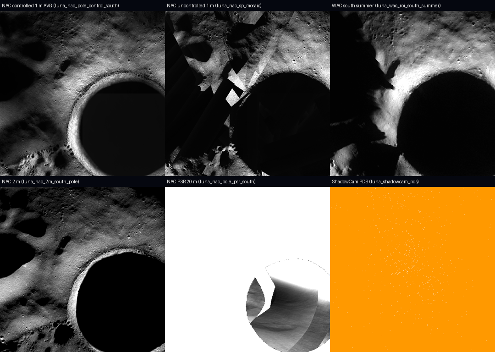

# Lunar Explorer — Verified Imagery Sources & Zoom-Dependent Architecture (for Codex)

| | |
|---|---|
| Audience | Codex (owner of the Lunar Explorer 2D map / LROC imagery pipeline) |
| Type | Research and requirements only. No application code, scientific calculation or Phase 6A/6A.1 file was changed. |
| Branch | `docs/lunar-imagery-requirements`, from `a9f7ec2` (Phase 5F). Not merged and not pushed. |
| Verified | 2026‑11‑14, by live HTTP requests (WMS GetCapabilities/GetMap, PDS S3 listings, PDS4 labels, TIFF headers read over byte ranges, CORS/range headers, timings). Anything **not** verified is marked as such. |

## 0. Target behaviour (from the product owner)

1. **Wide south‑polar view:** a geographically accurate, broad‑coverage WAC or genuine LOLA basemap, without unexplained blank grids or small isolated raster squares.
2. **Mid/close zoom:** progressively sharper NAC imagery wherever a validated, georeferenced source exists.
3. **PSRs:** optional ShadowCam imagery where it is officially available and spatially registered.
4. **Research sites:** accurate markers, source information, and a transition to local LOLA 5 m terrain and Horizons analysis.

## 1. Headline findings

| # | Finding | Consequence |
|---|---|---|
| F1 | **Every recommended product uses SELENORA's projection**: polar stereographic, origin −90°, central meridian 0°, sphere R = 1 737 400 m. This is stated in the PDS4 labels of the WAC 100 m, NAC controlled and ShadowCam products, and in PGDA's documentation for the LOLA products. | No reprojection is needed. Stop warping EPSG:4326 images near the pole; that is the main source of blur and distortion today. |
| F2 | Lunaserv WMS serves these layers **natively in `IAU2000:30120`** (south polar stereographic). `30118`/`30119` return blank at the pole. | Request tiles in `IAU2000:30120` with the stereographic metre bbox that OpenLayers already uses. |
| F3 | Lunaserv **moved**: `webmap.lroc.asu.edu` → **301** → `wms.im-ldi.com/lunaserv/wms`. | Update the endpoint (currently `LUNASERV_WMS` in `imagery_service.py`). |
| F4 | Lunaserv returns **opaque white for no‑data by default**. `TRANSPARENT=TRUE` + PNG gives real transparency (measured: 0 % → 77 % transparent pixels in the same request). | This explains the "blank grids/squares". Always request PNG with `TRANSPARENT=TRUE` for partial‑coverage layers, and show the gaps as an explicit "no data" pattern. |
| F5 | Lunaserv takes **1.2–3.2 s per 256 px tile** and **2.7–10 s per 1024 px image**. 4096 px took 108 s, and 8192 px timed out at 300 s. It sends `Cache-Control: max-age=0` and `Access-Control-Allow-Origin: *`. | Interactive use needs a server‑side tile cache. Never request very large single images. |
| F6 | PDS archive files (S3 at `pds.mcp.nasa.gov/data/store/img/...`) support **HTTP range (206)** with **CORS `*`**. Their `*.PYR.TIF` browse GeoTIFFs are **internally tiled (256²), uncompressed 8‑bit, with full overview pyramids**. | Tiles can be cut on demand from the official archive files without downloading 379–681 GB mosaics. |
| F7 | ShadowCam PDS publishes real **COG** controlled mosaics for 26 targeted PSRs, in the same projection, at **2 m, 5 m and 20 m**, aligned to the LOLA LDEM to within about 1 px. Range and CORS `*` are supported. Sunlit areas are **saturated**. | Use them as an optional overlay clipped to PSRs, never as a basemap. The 2023 Shackleton composite is a one‑off image, not a layer. |
| F8 | PGDA (Barker et al. 2023) publishes **LOLA DEM and hillshade COGs** (80°S at 20/40/80 m, 83°S at 10 m, 75°S at 30 m, 60°S at 60–240 m) in the same projection. They support range requests but send **no CORS header**. | This is the shadow‑free, gap‑free wide basemap. Cache it server‑side. |
| F9 | Licensing: **PDS‑delivered** LROC data is **public domain**. Images through **non‑PDS interfaces** (Lunaserv, website) are **copyrighted**; educational use with credit is permitted, commercial use needs permission. | Prefer tiles cut from PDS files. If Lunaserv tiles are shown, credit them and keep usage educational. |

## 2. Source catalogue (verified)

### 2.1 LROC WAC South Pole Summer Mosaic, the wide photographic basemap

| Item | Verified value |
|---|---|
| Official name / page | *WAC South Pole Summer Mosaic*, RDR `WAC_ROI_SOUTH_SUMMER` — <https://data.lroc.im-ldi.com/lroc/view_rdr/WAC_ROI_SOUTH_SUMMER> |
| Coverage / resolution | 45°S → 90°S; versions at 100 m/px (`_100M`, 28 786 × 28 786 px) and 256/128/64/32/16/8/4 px/deg |
| Acquisition | 21 Sep – 23 Oct 2010; sub‑solar point near its lowest (≈ 1.5°S); 643 nm band; projected on GLD100 + LOLA shape model (80–90°S) |
| Projection | Polar stereographic, lat₀ −90, lon₀ 0, R 1737.4 km. The PDS4 label gives `upperleft_corner_x/y` = 1 439 250 m (half of 28 786 × 100 m). The sign convention of that field must be confirmed with GDAL when integrating |
| Access | **PDS**: `…/LROLRC_2001/DATA/BDR/WAC_ROI/WAC_ROI_SOUTH_SUMMER/` (IMG float32, 100 M = 3.31 GB). **Browse GeoTIFFs**: `…/EXTRAS/BROWSE/WAC_ROI/WAC_ROI_SOUTH_SUMMER/` with `_100M.PYR.TIF` 1.13 GB (tiled 256², 8‑bit, overviews 100 m → 12.85 km), `_100M.TIF` 829 MB, `_100M.MASK.TIF`. **WMS**: Lunaserv layer `luna_wac_roi_south_summer`. Base URL: `https://pds.mcp.nasa.gov/data/store/img/lunar_reconnaissance_orbiter/pds4/lroc/lro-l-lroc-5-rdr/LROLRC_2001/` |
| Interactive mapping | **Yes.** Range‑read the `.PYR.TIF` overviews (best), or WMS in `IAU2000:30120` with a cache |
| Size / caching | Whole 45°S cap at 100 m ≈ 12.7 k tiles (≈ 250–330 MB as JPEG incl. pyramid). The 80°S cap only (r ≈ 304 km) ≈ 576 tiles at 100 m (≈ 12 MB). **Pre‑cache the 80°S cap entirely.** |
| Credit | NASA/GSFC/Arizona State University; cite Speyerer et al. (2020) LSSW #5132 |
| Limitations | **A single season, so large areas are in real shadow (black). This is not missing data.** The MASK.TIF separates no‑data from shadow. At 100 m it cannot show crater interiors in PSRs. |

### 2.2 LROC NAC South Pole **controlled** 1 m mosaics, the close‑zoom photographic layer

| Item | Verified value |
|---|---|
| Products | `NAC_POLE_SOUTH_CM_AVG` (average, recommended), `NAC_POLE_SOUTH_CM_MAX` (maximum pixel), `NAC_POLE_SOUTH_CM_005…CM_355` (36 sub‑solar‑longitude illumination mosaics) — e.g. <https://data.lroc.im-ldi.com/lroc/view_rdr/NAC_POLE_SOUTH_CM_005> |
| Coverage / resolution | 84°S → 90°S at **1 m/px**, as 40 polar‑stereographic tiles in 1.5° bands (4/8/12/16 tiles). Illumination mosaics cover only part of the region (e.g. CM_005: 19 tiles) |
| Control | 18 323 NAC images (2009–2013), ISIS jigsaw, 1 677 811 points, tied to LOLA tracks; residual variance 0.38 px, 2σ 0.8 px. **Controlled only 85–90°S**; the 84–85°S ring is uncontrolled |
| Projection | Polar stereographic, lat₀ −90, lon₀ 0, R 1737.4 km, 1 m (PDS4 label, e.g. tile `P848S0112`: 69 690 × 55 974 px) |
| Access | **PDS** IMG (float32, 2 bands): CM_AVG **681 GB**, CM_MAX 665 GB, CM_005 290 GB. **Browse**: `…/EXTRAS/BROWSE/NAC_POLE/NAC_POLE_SOUTH_CM_AVG/*.PYR.TIF`, BigTIFF, tiled 256², 8‑bit, overviews 1 → 512 m (e.g. tile P848S0112 `.PYR.TIF` 5.24 GB). **WMS**: `luna_nac_pole_control_south` |
| Interactive mapping | **Yes**, by range‑reading only the tiles and overview levels the viewport needs (never a bulk download), or via the WMS with a cache |
| Size / caching | Full 1 m pyramid is impossible to pre‑cache (≈ 2 M tiles). **On‑demand LRU cache** plus **pre‑cached AOIs**: 10 × 10 km at 1 m around each research site ≈ 1 600 tiles ≈ 50–65 MB per site incl. pyramid (≈ 0.5 GB for 8 sites) |
| Credit | NASA/GSFC/Arizona State University; cite Klem et al. (2014) LPSC #2885 |
| Limitations | **CM_AVG "does not accurately represent any realistic lighting condition"** (README), so label it as a morphology mosaic. PSR floors stay dark. Outside 84°S there is no NAC, so fall back to WAC with a visible coverage edge |

**Not recommended as a basemap.** `NAC_POLE_SOUTH` / `luna_nac_sp_mosaic` (uncontrolled 1 m, 85.5–90°S, 379 GB): its images "were not registered to one another". The contact sheet in §5 shows a visible patchwork of mismatched lighting.

### 2.3 LROC NAC 2 m South Pole mosaics (WMS only)

| Item | Verified value |
|---|---|
| Layers | `luna_nac_2m_south_pole` (*LROC NAC 2 m South Pole Mosaic*) and `luna_nac_2m_sp_mosaic` (*"small NAC South Pole Mosaic … for use by the ShadowCam team for planning"*) |
| Coverage | **Small**: the Shackleton – de Gerlache ridge – Spudis area, 2009–2010 images (28 + 54 + 58 NACs) |
| Accuracy | "Preliminary … absolute accuracy better than 20 m, maybe 10 m" (abstract) |
| Access | Lunaserv WMS only. No PDS RDR was found in this research |
| Recommendation | **Optional / low priority.** It is superseded by the controlled 1 m mosaic over the same area |

### 2.4 LROC NAC South Pole PSR mosaic (20 m)

| Item | Verified value |
|---|---|
| Product | `NAC_POLE_PSR_SOUTH` (PDS, 14.8 GB IMG + 3.7 GB `_STRETCH`) / WMS `luna_nac_pole_psr_south` |
| Coverage / resolution | 80°S → pole, **only inside LOLA‑defined PSRs**, 20 m/px |
| Limitations | Each image is stretched individually (1 %/99 %), and **the images were not registered to one another**. It is projected on the WAC GLD100 DTM |
| Recommendation | A **coarse PSR fallback** where no ShadowCam mosaic exists, labelled "stretched, unregistered" |

### 2.5 ShadowCam (KPLO/Danuri), the optional PSR overlay

| Item | Verified value |
|---|---|
| Archive | <https://pds.shadowcam.im-ldi.com/> (PDS4 bundle `kplo-shadowcam`): `observation/` (calibrated images and **COG** browse), `derived/` with `cmosaic` (controlled), `umosaic` (uncontrolled), `collarmosaic`, `lronac_cmosaic` (companion LROC NAC controlled mosaics), `dtm`. Releases every 3 months |
| Controlled mosaics (south) | amundsen01, cabeusb01, faustini01–11, idelsonl01, kocher01, kuhn01, **shackleton01–02**, shoemaker01, wiechertj01, sylvestern01, unnamed‑PSR‑in‑Rozhdestvenskiy01 … (26 targets incl. some northern) |
| Example (verified) | `derived/cmosaic/shackleton01/shadowcam_cmosaic_shackleton01_p896s1350_summer_11am_cog.tif` (404 MB, **2 m/px**, 89.01°S → pole, UL (−3686, 3685) m), plus `_5m_cog.tif` (67 MB) and `_20m_cog.tif` (4.3 MB) |
| Projection / accuracy | Polar stereographic, lat₀ −90, lon₀ 0, R 1 737 400 m. Bundle‑adjusted, then x/y shifted to the best LOLA LDEM: **"within 1 pixel"** (README); jigsaw residual reports included |
| Access | HTTP **range 206**, **CORS `*`**, true COGs, so a browser or backend can read them directly |
| Credit | **NASA/KARI/ASU** (ShadowCam); cite Grieser et al. (2025) LPSC #2523. Combined LROC + ShadowCam views carry both credits |
| Limitations | **Only targeted PSRs** (not a basemap). Images show **secondary (reflected) illumination**; **sunlit areas are saturated**, so clip to PSR polygons (`luna_psr_81s`, Mazarico et al. 2011, or ShadowCam/LOLA PSR vectors). Different seasons/times per mosaic. The **Lunaserv layers `luna_shadowcam_pds` / `luna_shadowcam_fi` are footprint layers, not imagery** (orange polygons, §5) |

The 2023 NASA image of Shackleton ("NASA Moon Camera Mosaic Sheds Light on Lunar South Pole", 19 Sep 2023, NASA/KARI/ASU) is a **curated composite** of ShadowCam (interior) and LROC (rim). It is **not** a global or polar basemap, and SELENORA must not present it as one. It can be reproduced in spirit only where both a ShadowCam `cmosaic` and NAC controlled coverage exist.

### 2.6 LOLA polar basemaps, the shadow‑free, gap‑free relief layer

| Item | Verified value |
|---|---|
| Product | PGDA *A New View of the Lunar South Pole from LOLA* — <https://pgda.gsfc.nasa.gov/products/90>; data DOI 10.60903/gsfcpgda-lola-spole; cite Barker et al. 2023, PSJ 4, 183 |
| Files | `LDEM_*_ADJ_HILL.TIF` hillshade (45° altitude, 45° azimuth): 80°S at **20 m (1.3 GB)**, 40 m (330 MB), 80 m (85 MB); 83°S at 10 m (2.5 GB); 75°S at 30 m (1.3 GB); 60°S at 60/120/240 m. Also DEM, error, effective resolution, slope, and LPSR (PSR) layers |
| Projection | South polar stereographic X/Y in metres, MOON_ME (DE421) — **COGs** |
| Access | Range 206; **no CORS header**, so the backend must fetch and cache |
| Recommendation | **Default wide basemap.** Always complete, no shadows, real LOLA data. The hillshade light is a fixed display convention (45°/45°) and must be labelled "not sunlight" |
| Already in SELENORA | LOLA 5 m site tiles (Barker PGDA product 78: Sites 1, 4, 7, 11). They are the *local* terrain source. **They are small squares by nature and must never be the wide basemap.** That is the root cause of the "small isolated raster squares" |

### 2.7 Other checked sources

| Source | Status |
|---|---|
| NASA Moon Trek `LRO_WAC_Mosaic_Global_303ppd_v02` (WMTS, equirectangular) | Verified earlier (5E). Distorted near the pole, so reference only |
| Moon Trek south‑polar (SP) WMTS layers | **Not verified** in this research (no capabilities URL confirmed). Optional follow‑up |
| Lunaserv `luna_polar_illumination(_pct)` (WAC time‑weighted illumination, 88–90°) | Exists; a science product, not imagery. Do not mix it with Horizons results |
| Lunaserv `luna_psr_81s` (LOLA PSR shapefile, Mazarico 2011) | Exists; use it for PSR outlines and ShadowCam clipping |

## 3. Recommended zoom‑dependent architecture

### 3.1 Principle

One map CRS everywhere: SELENORA polar stereographic (= `IAU2000:30120` = the PDS products' own projection). There is **one fixed resolution ladder** and a **backend tile service**. Each layer declares the scales it is valid for. The client never sees a blank square: every tile resolves to imagery, an explicit no‑data pattern, or a lower‑resolution parent.

```
                 metres per screen pixel  (OpenLayers resolution)
  ┌────────────┬─────────────┬───────────────┬──────────────┬──────────────┐
  │  ≥ 400 m   │  100–400 m  │   10–100 m    │    1–10 m    │  local 5 m   │
  ├────────────┼─────────────┼───────────────┼──────────────┼──────────────┤
  │ LOLA HILL  │ LOLA HILL   │ LOLA HILL 20m │ (relief off) │ LOLA 5 m 3D  │  relief (default ON)
  │ 80/240 m   │ 40/80 m     │ /10 m (83°S)  │              │ (existing)   │
  │ WAC 100 m  │ WAC 100 m   │ NAC CM_AVG    │ NAC CM_AVG   │      —       │  photo (toggle)
  │ overviews  │             │ overviews     │ 1–4 m        │              │
  │     —      │      —      │ ShadowCam 20m │ ShadowCam    │      —       │  PSR overlay (opt-in,
  │            │             │ NAC PSR 20 m  │ 5 m / 2 m    │              │   clipped to PSRs)
  └────────────┴─────────────┴───────────────┴──────────────┴──────────────┘
  Outside 84°S, NAC is unavailable: the photo stays on WAC, with a visible "NAC coverage edge".
```

### 3.2 Backend tile service (replaces the single 768 px EPSG:4326 preview)

- **Endpoint (proposed):** `GET /api/v1/maps/tiles/{layer_id}/{z}/{x}/{y}.{png|jpg}` on a fixed TileGrid. Origin (−R_ext, +R_ext), 256 px, resolutions `[3200, 1600, 800, 400, 200, 100, 50, 25, 12.5, 6.25, 3.125, 1.5625, 0.78125] m/px` or similar. Publish the grid in `/maps/layers`.
- **Readers, in preference order:**
  1. Range reads of PDS `*.PYR.TIF` / ShadowCam / PGDA COGs, using GDAL `/vsicurl/` or rasterio, picking the overview level closest to the tile resolution. No reprojection: copy or resample within the same CRS. Pad with the MASK or no‑data value, then emit transparent PNG.
  2. Lunaserv WMS `GetMap` in `IAU2000:30120`, PNG, `TRANSPARENT=TRUE`, only for layers without a PDS file (NAC 2 m).
  3. Never EPSG:4326 for anything south of about 60°S.
- **Cache:** on‑disk content‑addressed tiles (`layer/z/x/y` + source version), an LRU byte budget (e.g. 5–10 GB), and immutable `Cache-Control` to the browser. Pre‑warm: WAC 80°S cap, LOLA HILL 80 m and 40 m entirely, and site AOIs (§2.2).
- **Allow‑list only:** keep the 5E rule that no arbitrary URL is proxied. Add the new hosts `pds.mcp.nasa.gov`, `pds.shadowcam.im-ldi.com`, `pgda.gsfc.nasa.gov` and `wms.im-ldi.com`.
- **Metadata per tile layer:** product ID, URL, acquisition dates, resolution, control status (controlled/uncontrolled), lighting note (single season / average / max / secondary illumination), credit string and licence channel (PDS public domain vs Lunaserv copyrighted).

### 3.3 Client (Lunar Explorer) behaviour

- OpenLayers `XYZ`/`TileImage` with a custom `TileGrid` in the existing `SELENORA:MOON_SPS` projection. Remove the single‑image `ImageStatic` preview for these layers.
- Layer switcher: **Relief (LOLA)** default · **Photo (WAC→NAC)** · **PSR (ShadowCam)** opt‑in · PSR outlines · NAC coverage edge · LOLA 5 m tile footprints.
- **Legend wording:**
  - "Black in photos = real shadow at the time of imaging, not missing data."
  - "Hatched = no data."
  - "NAC CM_AVG is an average of many images and shows no real lighting moment."
  - "Hillshade light is a display convention, not the Sun."
  - "Sun/Earth visibility comes only from Horizons + LOLA."
- **Site selection:** the marker sits at backend coordinates. The info panel shows source and resolution at that point (e.g. "NAC controlled 1 m, LOLA HILL 20 m, ShadowCam: shackleton01 available"), then hands off to the existing **LOLA 5 m 3D terrain** and **Horizons analysis**. No new science is needed.

## 4. Integration priorities for Codex

| P | Work item | Acceptance check |
|---|---|---|
| **P0** | Update the Lunaserv host (F3); request **`IAU2000:30120` + PNG `TRANSPARENT=TRUE`**, not EPSG:4326 (F2, F4) | Same 30 km window as §5: Shackleton rim at the expected stereographic position; no opaque white areas |
| **P0** | **LOLA HILL (PGDA 80°S 80 m → 20 m) as the default wide basemap.** The 5 m site tiles become local‑only overlays | The wide view at 80–90°S has no gaps or isolated squares |
| **P1** | Backend tile service + cache (§3.2) with the **WAC 100 m** photo layer from the PDS `.PYR.TIF` | Pan/zoom at 100–400 m/px gives warm‑cache tiles in under 100 ms; cold tiles show a placeholder, never a blank |
| **P1** | **NAC CM_AVG 1 m** by range reads, with the 84°S coverage edge and an "average mosaic" label | At a research site, zooming from 100 m → 1 m/px sharpens progressively; outside 84°S it stays on WAC with a visible edge |
| **P2** | **ShadowCam controlled mosaics** (5 m/2 m COG) as an opt‑in overlay **clipped to PSR polygons**, with NASA/KARI/ASU credit and season/time | At Shackleton the floor shows ShadowCam detail; the rim keeps NAC; no saturated sunlit ShadowCam pixels are shown |
| **P2** | NAC PSR 20 m fallback for PSRs without ShadowCam | Labelled "stretched, unregistered" |
| **P3** | Illumination‑specific NAC mosaics (`CM_005…CM_355`) as an educational "lighting at sub‑solar longitude X" viewer | Clearly separated from Horizons results |
| **P3** | Verify Moon Trek SP WMTS (not verified here) | Only adopt it if capabilities confirm south polar stereographic |

**Validation required before release (Codex):**

1. Numeric registration check of one tile per layer against the LOLA 20 m hillshade, e.g. phase correlation of crater rims. Expect ≤ 1–2 px at the layer's resolution (ShadowCam: within 1 px of the LOLA LDEM per README).
2. Confirm the IAU2000:30120 axis convention matches `SELENORA:MOON_SPS` (x = ρ·sin λ, y = ρ·cos λ). This research checked it only visually (Shackleton within about 1 km at 58 m/px).
3. Network‑failure states (Lunaserv slow or 5xx; PDS 5xx) fall back to the parent level with a message.

## 5. Evidence: same 30 × 30 km window at Shackleton (WMS `IAU2000:30120`, 512 px)



From left to right and top to bottom:

1. NAC controlled 1 m AVG: clean, consistent.
2. NAC uncontrolled 1 m: patchwork of unregistered images.
3. WAC summer: long real shadows.
4. NAC 2 m: good but small area.
5. NAC PSR 20 m: interior only; white = no data, because `TRANSPARENT` was not set.
6. `luna_shadowcam_pds`: **footprint polygons, not imagery**.

## 6. Measurements (2026‑11‑14, from this workstation)

| Request | Result |
|---|---|
| Lunaserv 256² JPEG tile (NAC 1 m / WAC) | 1.2–3.2 s each |
| Lunaserv 1024² (WAC 600 km window / NAC 4 km window) | 9.9 s / 4.5 s |
| Lunaserv 4096² / 8192² NAC | 108 s / timed out at 300 s |
| PDS S3 1‑byte range (WAC PYR.TIF) | 0.86 s |
| ShadowCam COG 64 KB range | 1.17 s |
| CORS | Lunaserv `*`; PDS S3 `*`; ShadowCam `*`; **PGDA none** |

## 7. Sources

- Lunaserv WMS capabilities: <https://wms.im-ldi.com/lunaserv/wms?SERVICE=WMS&REQUEST=GetCapabilities&VERSION=1.1.1>
- LROC RDR pages: <https://data.lroc.im-ldi.com/lroc/view_rdr/WAC_ROI_SOUTH_SUMMER>, <https://data.lroc.im-ldi.com/lroc/view_rdr/NAC_POLE_SOUTH>, <https://data.lroc.im-ldi.com/lroc/view_rdr/NAC_POLE_SOUTH_CM_005>
- LROC PDS (S3 store): `https://pds.mcp.nasa.gov/data/store/img/lunar_reconnaissance_orbiter/pds4/lroc/lro-l-lroc-5-rdr/LROLRC_2001/` (DATA/BDR/…, EXTRAS/BROWSE/…, READMEs and PDS4 `.xml` labels)
- LROC terms & citation: <https://lroc.im-ldi.com/about/terms>
- ShadowCam PDS archive: <https://pds.shadowcam.im-ldi.com/> (SIS: <https://pds.shadowcam.im-ldi.com/document/archsis.pdf>); first look at ShadowCam PDS data (LPSC 2024 #1543): <https://www.hou.usra.edu/meetings/lpsc2024/pdf/1543.pdf>; release notes: <https://shadowcam.im-ldi.com/posts/1500>
- NASA Shackleton composite (2023): <https://www.nasa.gov/missions/lro/nasa-moon-camera-mosaic-sheds-light-on-lunar-south-pole/>
- PGDA LOLA south pole products: <https://pgda.gsfc.nasa.gov/products/90> (Barker et al. 2023, PSJ 4:183, doi:10.3847/PSJ/acf3e1), <https://pgda.gsfc.nasa.gov/products/78>
- NASA media usage guidelines: <https://www.nasa.gov/nasa-brand-center/images-and-media/>
