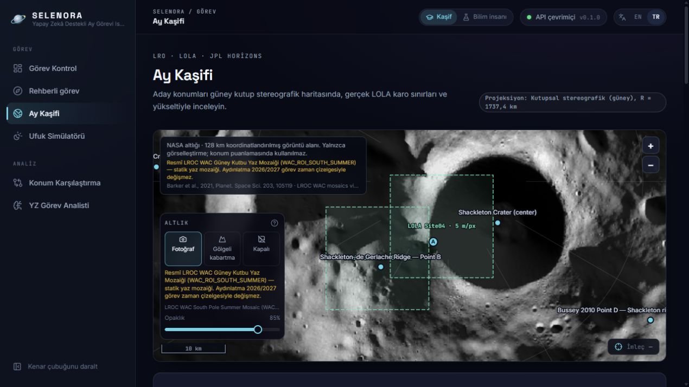
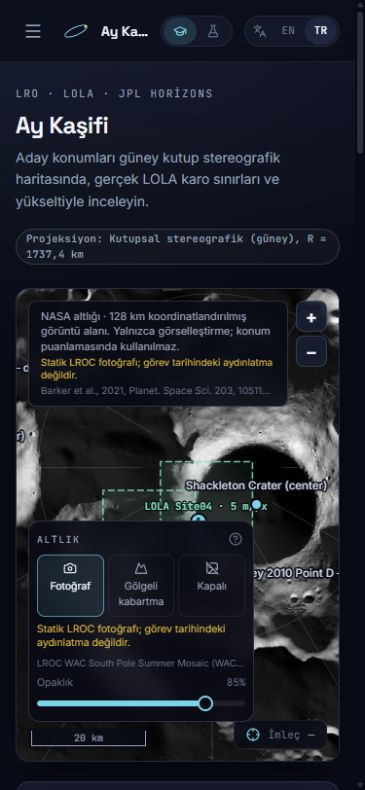

# SELENORA — Phase 5F.1 LROC Stabilization Report

Date: 2026-11-14 (Europe/Istanbul).

Lunar Explorer now starts with prepared, georeferenced NASA imagery, retains a real LOLA fallback, and refines the image after the user navigates. The photographic path requests the matching lunar polar CRS directly. Image resources survive unrelated React renders and mode changes.

## 1. Git baseline and safety

- Starting commit: `a9f7ec2e57abbf8ddb3541c02c32cbd2e9159a2e`.
- Protected branch: `feature/phase5f-immersive-integration`, still at that commit.
- Development branch, created before source edits: `feature/phase5f1-lroc-fix`.
- Git worktree identity: `.git/worktrees/phase5f1`.
- Existing managed checkout preserved at `C:/Users/ahmet/.codex/worktrees/phase5f-lroc-startup/phase5f`. No additional worktree was created to rename it.
- Implementation/evidence commit: `2731774dbd1406e23a17dcdb4245aa6b2ccebdde`.
- No reset, worktree deletion, merge, push, force-push or competition submission. Original SQLite data and scientific engines were preserved. Browser QA used a separate database under the gitignored QA cache directory.

## 2. Confirmed causes

1. **Remote-dependent first image.** The baseline measurement was 20.28 s total, including 19.66 s in Lunaserv. Its five-minute in-process cache did not survive process restart.
2. **Oversized geographic sampling.** A 48 × 32 km polar view could produce a geographic BBOX approximately `[-217.107, -90, 217.107, -60]`. Longitude-derived padding was also applied to latitude. A 434° × 30° source image was then warped from only 1024 × 1024 samples, destroying local detail. Black shadow was also treated as nodata, and source alpha was dropped.
3. **Resource reconstruction.** A new preview array on each render drove unconditional `ImageStatic` replacement. Cursor/UI changes could cause repeated decoding. Transport success was treated as display readiness, object URLs were not owned/released, and viewport requests did not consume cancellation signals.

The old map cap/aspect/z-order fixes described in the Phase 5F report remain relevant. This patch fixes the remaining acquisition and lifecycle problems rather than changing scientific projection or scoring formulas.

## 3. Live WMS verification and corrected requests

The actual [Lunaserv GetCapabilities](https://webmap.lroc.asu.edu/lunaserv/wms?SERVICE=WMS&VERSION=1.1.1&REQUEST=GetCapabilities) response was downloaded on 2026-11-14. The compact [verification record](screenshots/phase5f1/capabilities-verification.json) includes its SHA-256, advertised formats and layer names. The original XML stays in gitignored `data/cache/lroc/`.

- WMS version: **1.1.1**.
- PNG is advertised, along with TIFF/JPEG and other formats.
- The parent advertises **`IAU2000:30120`**, inherited by `luna_wac_roi_south_summer` and `luna_nac_2m_south_pole`.
- WAC South Summer remains the selected photographic source. NAC was verified as available in the catalogue but was not substituted into this release.
- The matching lunar south-polar geometry uses a sphere of radius 1,737,400 m, `lat_0=-90`, `lon_0=0`, `k=1`, metre x/y axes. Numeric control points and visual comparison with LOLA checked the placement independently.

Example corrected request parameters:

```text
SERVICE=WMS&VERSION=1.1.1&REQUEST=GetMap
LAYERS=luna_wac_roi_south_summer
SRS=IAU2000:30120
BBOX=-30000,-26000,18000,6000
WIDTH=768&HEIGHT=512
FORMAT=image/png&TRANSPARENT=true
```

The service receives exactly the requested projected bounds and output dimensions. There is no geographic envelope, degree padding, or geographic reprojection fallback. Crossing ±180° longitude is continuous in these polar x/y axes; it never creates an ordinary 434° geographic window. Tests cover an antimeridian crossing, a pole-containing window, invalid bounds and thin/non-square images.

The original upstream PNG is returned unchanged after validating its format, dimensions and coverage. Black photographic shadows remain valid pixels; only source alpha denotes missing coverage. LOLA previews retain their actual clipped bounds and make missing data transparent. The client rejects unknown CRS metadata and missing placement headers for potentially clipped rasters.

## 4. Geographic alignment

The same 1,737,400 m south-polar equations position both the rasters and markers. [Control-point calculations](screenshots/phase5f1/alignment-control-points.json) give:

| Feature | Longitude / latitude | Projected x, y (m) | Pixel position in the example 768 × 512 image |
|---|---|---|---|
| Shackleton centre | 129.78°, −89.67° | 7690.24, −6402.72 | 603.04, 198.44 |
| Shackleton Rim Point A | −166.00°, −89.68° | −2347.49, −9415.26 | 442.44, 246.64 |
| Connecting Ridge Point B | −141.80°, −89.44° | −10501.32, −13344.80 | 311.98, 309.52 |

Photo and LOLA mode screenshots were taken without changing the view. Shackleton's outline, its centre marker, rim point and the two LOLA footprints retain their locations in both modes. The direct native image also visibly resolves the crater rim instead of the baseline radial smear. This is a georeferencing/visual alignment check, not a new mission-grade registration survey; the existing reference-coordinate and product-frame limitations remain.

The [official WAC product](https://data.lroc.im-ldi.com/lroc/view_rdr/WAC_ROI_SOUTH_SUMMER) is a static photographic mosaic with polar-stereographic products, including a 100 m/pixel product. Overzoom does not create additional source detail. UI attribution and the static-illumination disclaimer are retained in EN/TR. Photographic brightness is not presented as Horizons illumination at a selected mission date.

## 5. Initial loading and fallback

- Default composition frames the Shackleton/Connecting Ridge area, using `[-30000, -26000, 18000, 6000]` as the initial fit extent.
- A canonical **128 × 128 km** overview at `[-64000, -64000, 64000, 64000]`, 768 × 768 pixels, covers the desktop and mobile starting view. Its image keeps these actual bounds; it is never stretched to a new viewport.
- Photo and genuine NASA PGDA LOLA hillshade overviews begin loading automatically once the live catalogue is available.
- Initial opening uses the prepared overview. New detail requests begin after user pan/zoom, avoiding a redundant initial remote request and competing auto-fit windows.
- Hillshade stays below photographic layers. A valid cached photographic overview stays visible while detail is loading or unavailable; it is not covered by a fallback layer.
- A failed LROC request ends loading, explains the failure and offers **Retry**. If no photo is available, the real cached LOLA hillshade remains visible.
- Desktop columns begin at the larger breakpoint, avoiding a narrow central strip. Mobile controls use the shorter static-image disclaimer while keeping attribution and all three modes.

## 6. Persistent cache and deployment

`map_preview_service.py` is the common acquisition entry point for photography and other raster previews. `map_preview_cache.py` stores derived PNGs and metadata under gitignored `data/cache/map_previews/`. `SELENORA_MAP_CACHE_DIR` can point to a persistent volume through process environment or backend `.env` configuration.

The SHA-256 cache identity includes layer ID, exact requested bounds, map CRS, output dimensions, maximum edge, source identity and processing version (`phase5f1-polar-direct-v1`). Metadata includes actual returned bounds, attribution, nodata fraction and a PNG checksum. Reads validate image dimensions/checksum. Files are replaced atomically. In-process Futures plus a disk lease coalesce identical simultaneous requests, including across workers sharing the same directory. Failed acquisitions are not cached. Storage is capped at 256 records, with canonical startup overviews pinned.

Preparation before traffic:

```powershell
cd backend
python -m app.services.prepare_map_previews
```

The command prepares hillshade first, then LROC. `start-selenora.bat` now runs it before starting the app. Deployments using uvicorn directly must run the preparation command as a release/setup step and persist the cache directory. The launcher continues with a warning if preparation is incomplete; Explorer then reports live loading/error states.

This worktree's initial preparation measured **53.172 s** for the uncached remote LOLA overview and **12.305 s** for LROC. A later fresh-process preparation read both from disk in **26 ms / 14 ms**, with no new NASA acquisition.

## 7. React/OpenLayers lifecycle

- React Query stores immutable image Blob payloads and structurally shared descriptors, rather than owning object URLs.
- The HTTP preview URL also includes the processing version, avoiding browser-cache ambiguity after a future processing update.
- `RasterSourceSlot` owns each slot's source and object URL. Matching Blob + bounds reuse the same source; unrelated renders and mode switches do not reconstruct it.
- Pending replacements load/decode before replacing the displayed source. Readiness is reported after successful decode and a map `postrender`, rather than at HTTP 200.
- Generation guards reject stale decode callbacks. Viewport-specific query keys and consumed `AbortSignal`s cancel/ignore obsolete HTTP work.
- Pan/zoom is debounced by 280 ms. Old geographic imagery stays at its original extent during acquisition.
- Replaced, cancelled and unmounted resources revoke their object URLs and remove listeners. Query-cache Blob reuse does not leave dangling blob URLs.
- The obsolete `ImageStatic.imageSize` option was removed: the installed OpenLayers version reads intrinsic PNG dimensions. Backend dimensions and placement metadata are explicitly validated instead.

## 8. Measured performance

Browser measurements start at map construction, measuring the empty-map interval rather than Codex/browser-tool overhead. `requestMs` measures Axios acquisition; `loadMs` covers source decode and the first following map paint. These are individual local measurements, not a latency SLA. Different footprints/resolutions are identified explicitly.

| Scenario | Acquisition | Decode / paint | Actual image display / result |
|---|---:|---:|---|
| Baseline 48 × 32 km geographic-warp path | 19.66 s upstream | included in total | 20.28 s preview generation |
| Direct polar sample, same 48 × 32 km / 768 × 512 | 4.05 s | not separately instrumented | Clear original polar PNG |
| Empty server-cache initial 128 km overview | 13.254 s HTTP; 13.165 s upstream | 56.4 ms | **13.598 s** from map construction |
| Second browser visit | Photo HTTP 99 ms | 50.7 ms | First basemap **357.8 ms**, photo **405.0 ms** |
| Final normal desktop opening | Photo HTTP 62.1 ms | 21.7 ms | First basemap **285.4 ms**, photo **304.7 ms** |
| 375 px warm opening | Photo HTTP 62.7 ms | 43.5 ms | Photo **407.8 ms** |
| Zoom to 40 × 20 km / 768 × 384 | Photo HTTP 2.488 s | 43.7 ms | New photo rendered; overview remained visible |
| Pan to another 40 × 20 km region | Photo HTTP 3.905 s | 33.3 ms | New photo rendered at the new bounds |
| Warm startup server reads | 75.79 / 29.03 ms | browser measured separately | `HIT`, no upstream call |
| Server process restart, warm reads | 111.82 / 9.99 ms | browser measured separately | `HIT` persisted across process restart |
| New 24 km region | First attempt timed out at 30.968 s; retry 2.847 s | browser pan tested separately | Error was not cached; retry succeeded |
| Same 24 km region, confirmed warm | **30.27 ms** | n/a, direct API measurement | `HIT` |
| Two simultaneous new 20 km / 256 px requests | 2.013 s each | n/a, direct API measurement | One `MISS`, one `COALESCED`; **one** real WMS request |
| LROC 503 with prepared LOLA | Hillshade HTTP 72.8 ms | 17.7 ms | Real fallback displayed in **266.0 ms** |

Raw evidence: [cold](screenshots/phase5f1/01-desktop-cold-metrics.json), [warm](screenshots/phase5f1/02-desktop-warm-metrics.json), [zoom](screenshots/phase5f1/05-desktop-zoom-metrics.json), [pan](screenshots/phase5f1/06-desktop-pan-metrics.json), [mobile](screenshots/phase5f1/07-mobile-375-metrics.json), [HTTP measurements](screenshots/phase5f1/http-metrics.json), [restart/warm confirmation](screenshots/phase5f1/http-warm-confirmation.json), [final desktop](screenshots/phase5f1/14-final-desktop-metrics.json).

The first HTTP measurement file labels its post-timeout retry `new-region-warm`; its actual `MISS` correctly shows this was a retry, not a cache hit. The separate warm-confirmation file records the true subsequent hit. Browser HTTP caches can similarly retain the original response's `MISS`/`COALESCED` header; the direct API measurements distinguish disk hits.

The [upstream acquisition log snapshot](screenshots/phase5f1/upstream-measurements.json) contains 11 attempts: **7 successful real WMS requests, 3 real timeouts and 1 injected failure before any remote request**. The whole-session count includes responsive/rapid-navigation windows and the HTTP benchmark. Startup, zoom and pan each used one real request for their new key. Warm visits/mode changes made no additional LROC call for those keys. The duplicate-request benchmark contains exactly one WMS request for its shared BBOX.

## 9. Real browser verification

In-app Chromium was used with isolated API/Vite ports: normal app **8041 / 5181**; QA app **8042 / 5182**. No existing Phase 5F servers were reused or stopped. The 375 × 812 viewport has a 365 px document width after its scrollbar; screenshots capture the content surface. Temporary viewport overrides were reset at completion.

| Scenario | Verified result / evidence |
|---|---|
| First visit with empty cache | Actual LROC photographic pixels; `01-desktop-cold-photo.jpg` |
| Second visit / initial Photo | Disk/browser reuse; `02-desktop-warm-photo.jpg` |
| Hillshade | Genuine NASA LOLA, same feature/marker positions; `03-desktop-lola-hillshade.jpg` |
| Photo → Hillshade → Photo | Cached sources reused; `04-desktop-photo-return.jpg` |
| Zoom in | New native-polar image; `05-desktop-zoom-photo.jpg` |
| Pan to another region | Correct new bounds, retained context; `06-desktop-pan-photo.jpg` |
| Zoom out / rapid zoom | Latest viewport retained; no stale response overwrite; raw acquisition log plus cancellation/generation unit tests |
| Mobile 375 px | Photo, readable controls and correctly located sites; `07-mobile-375-photo.jpg`, final `13-final-mobile-photo.jpg` |
| Remote LROC 503 | QA-only acquisition failure; real LOLA remained, Retry offered; `08-lroc-503-lola-fallback.jpg` |
| Retry / restoration | Actual LROC restored; `09-retry-restored-photo.jpg` |
| Network/API interruption | QA API stopped during pan, cached photo remained; `10-api-disconnected-cached-photo.jpg` |
| Offline Hillshade | Switched to genuine cached LOLA while API offline; `11-api-disconnected-lola.jpg` |
| Off | Raster hidden intentionally, vectors preserved; `12-off-mode.jpg` |
| Final normal app | Clean console, native photo and markers; `14-final-desktop-photo.jpg` |

Fault injection exists only in `tests/browser_map_server.py`, bound to loopback with a separate QA DB/cache. Its temporary failure marker was removed and the real startup cache restored. The normal development API/frontend were restarted after interruption tests. The final browser console contained no errors or warnings.





## 10. Automated validation

| Check | Result |
|---|---|
| Final backend regression command: `pytest -o addopts= -q -m 'not live'` | **133 passed, 1 skipped, 3 deselected**, 12.07 s |
| Earlier full run including live-marked tests | **136 passed, 1 skipped**, 30.40 s |
| New Phase 5F.1 backend tests | **15 passed** |
| Final frontend Vitest | **85 passed**, 14 files |
| TypeScript `tsc -b` (strict project configuration) | Passed |
| `npm run build` | Passed |
| `npm run lint` / oxlint | Passed, exit 0; existing non-blocking React export/effect/memoization warnings remain |
| `git diff --check` | Passed |

Added tests cover exact WMS BBOX/CRS, antimeridian and pole windows, thin-image dimensions, invalid bounds, alpha/black-shadow semantics, wrong-size/no-coverage errors, cache identity, persistence/corruption, simultaneous request coalescing, failure/retry, clipped-bound metadata, API headers, control-point orientation, stable OpenLayers resources, deferred paint readiness, stale decode rejection, URL cleanup, AbortSignal use, out-of-order HTTP results, fallback states, cached mode changes and overview-only startup.

Python used the existing project venv, with the new worktree's source and test databases; no global packages were installed. Frontend dependencies were copied into this checkout. The actual LOLA input directory was linked for read access. The original database was not reset. Existing chart-size warnings in jsdom and the pre-existing large 3D bundle warning do not fail the checks.

## 11. Changed areas

| Area | Files |
|---|---|
| Native photographic acquisition / metadata | `backend/app/services/imagery_service.py`, `nasa_layer_catalog.py` |
| Persistent acquisition / cache / preparation | `map_preview_service.py`, `map_preview_cache.py`, `prepare_map_previews.py` |
| Raster nodata / HTTP placement and cache metadata | `raster_preview_service.py`, `backend/app/api/v1/maps.py`, `backend/app/main.py` |
| Persistent cache configuration / launch | `backend/app/core/config.py`, `backend/.env.example`, `start-selenora.bat` |
| Frontend request and source ownership | `contracts.ts`, `useExplorerPreviews.ts`, `RasterSourceSlot.ts`, `LunarMap.tsx`, `ExplorerPage.tsx` |
| Controls / explanation | `BasemapControl.tsx`, phase5a/phase5d EN/TR locale files |
| Tests / reproducible QA | Backend Phase 5F.1 tests, isolated cache fixture, updated imagery test, browser/HTTP QA scripts; frontend contract, slot and hook tests |
| Evidence | This report, compatibility report link, `docs/screenshots/phase5f1/` |

## 12. Remaining limits

- A completely empty server cache still requires real NASA acquisition: the measured first photo was 13.60 s. Prepared persistent startup images are required for the fast normal-opening path; no invented image is used when both cache and external sources are absent.
- Lunaserv still occasionally times out on a previously unseen window. A bounded error state, retained valid imagery, genuine hillshade and Retry handle that condition. New-region latency remains dependent on the external provider.
- Client cancellation prevents obsolete UI updates. A Python/GDAL/WMS operation already executing server-side may continue until its I/O timeout and populate the cache; it is not force-killed.
- Coverage was visually verified around Shackleton/Connecting Ridge and the tested pan windows. The full WAC mosaic was not exhaustively surveyed. Fully transparent source windows produce an explicit unavailable error; partial source gaps retain alpha. No new native geographic coverage was fabricated.
- Photography has the WAC product's finite spatial resolution and static lighting. LOLA hillshade and Horizons Sun/Earth states remain separate concepts. JPL ephemeris, validated terrain horizons, true-north/grid convergence, deterministic scoring, UNKNOWN classification and DeepSeek evidence safeguards were not changed.
- Generated caches, raw raster inputs, DBs, dependency folders, `.env` files and credentials are excluded from the commits. Only the requested screenshots, compact metadata and source/tests are versioned.

## 13. Delivery

Branch: **`feature/phase5f1-lroc-fix`**. Implementation/evidence commit: **`2731774dbd1406e23a17dcdb4245aa6b2ccebdde`**. This report is delivered in a following documentation commit; its exact final HEAD is reported with delivery.

Normal local review: [Lunar Explorer](http://127.0.0.1:5181/explorer), backed by this worktree on API port 8041. No push or merge was performed.
