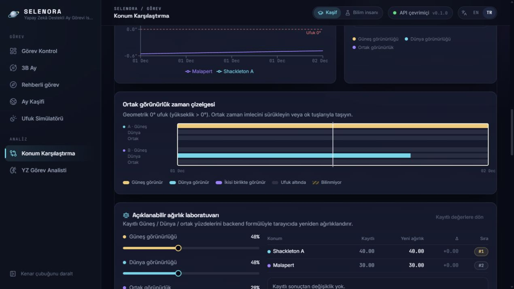
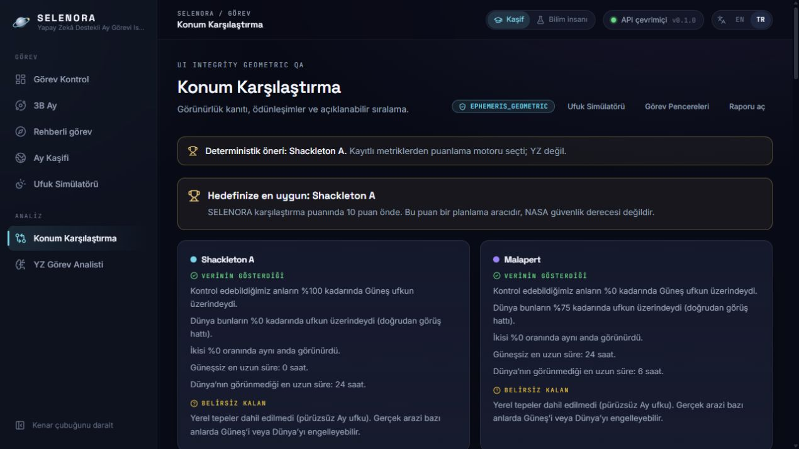
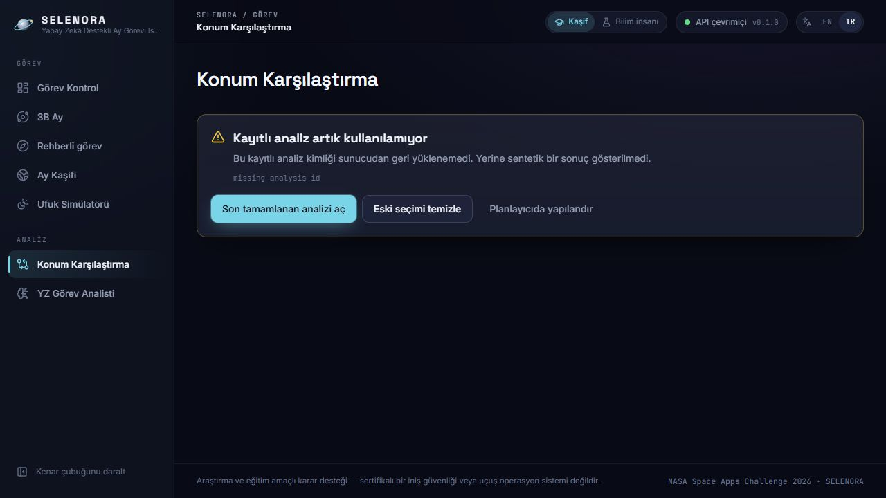
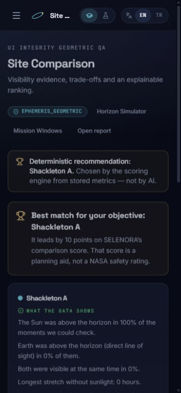

# SELENORA Phase 6C UI Integrity Hotfix Report

## Scope and provenance

- Stable base: `f01d2b4` (`Enable custom research points from the 3D Moon.`)
- Worktree: `.worktrees/phase6c-ui-hardening`
- Branch: `feature/phase6c-ui-hardening`
- H3 commit: `529512e` (`fix: preserve geometric horizon states`)
- H4 commit: `e83af9d` (`fix: restore active comparison analyses`)
- No merge or push was performed.
- Phase 7A event files, Cursor's science-hardening worktree, Phase 6C.1 map files,
  MoonPage, Mission Planner science, and backend geospatial APIs were not modified.

The live browser QA processes were started directly from this worktree on isolated
ports (`frontend 5216`, `backend 8061`). The backend health response advertised
API `v1`, service `v0.1.0`, environment `test`, and scientific algorithm
`0.3.1-phase3.3`. The test database was isolated from all normal SELENORA data.

## Reproduction results

### H3 — GEOMETRIC state mislabeled as terrain-blocked

The pre-fix regression test reproduced the defect with an authoritative
`/epochs` response whose top-level `horizon_model` was `GEOMETRIC` and whose
below-zero Sun state used the backend contract value `BLOCKED`. The adapter
returned UI state `BLOCKED`; the existing translation correctly rendered that
state as `Terrain-blocked` / `Arazi engelli`.

Root cause: `resolveSiteEpochs()` discarded `EpochsResponse.horizon_model` when it
converted authoritative samples. `authoritativeSampleToEpoch()` therefore treated
the final state as terrain-aware even when the analysis was geometric. This was a
frontend semantic adaptation defect, not a backend calculation defect.

### H4 — Comparison could replace a saved analysis with demo state

The pre-fix regression test set `workspaceStore.analysisId` and opened the normal
`/comparison` navigation target. `useAnalysis()` was never called. Only the
parameterized `/comparison/:analysisId` route loaded a stored result; the normal
sidebar route always entered `DemoComparisonView`.

Planner navigation usually used the parameterized route, but did not persist its
successful analysis ID into `workspaceStore`. As a result, a later visit through
the standard Comparison navigation could lose the user's active analysis and
fall through to empty or synthetic demo content.

## Implemented changes

### Authoritative horizon-state preservation

- `resolveSiteEpochs()` now passes the authoritative response's top-level horizon
  model into the sample adapter. The stored analysis model is a fallback only.
- In `GEOMETRIC` mode, the backend contract's non-visible `BLOCKED` state is
  rendered as `BELOW_HORIZON`.
- In `TERRAIN` mode, an authoritative `BLOCKED` state remains terrain-blocked.
- `VISIBLE` and `UNKNOWN` pass through unchanged. No clear-sky or terrain state is
  inferred from missing data.
- The geometric companion states are always mapped with geometric semantics.
- A regression fixture covers an authoritative GEOMETRIC `/epochs` payload,
  below-zero elevation, and an independent `UNKNOWN` body state.

### Saved-analysis selection and demo isolation

Comparison source priority is now explicit:

1. `/comparison/:analysisId` route ID.
2. Explicit `/comparison?source=demo` preview request.
3. Persisted `workspaceStore.analysisId` on the normal `/comparison` route.
4. Empty/demo entry surface when no saved selection exists.

Additional safeguards:

- A completed stored analysis loaded by route is persisted as the active workspace
  analysis.
- A successful real Planner analysis clears old demo data, persists its analysis
  ID, and navigates to its parameterized Comparison route.
- Synthetic Planner results link to the explicit `?source=demo` route.
- Starting or resetting a real Planner run clears stale in-memory demo output.
- A missing stored analysis (`404`) shows the stale ID and explicitly states that
  no synthetic result was substituted.
- The stale state can open the newest completed analysis, clear the stale
  selection, or return to Planner. Generic network/server failures retain the
  normal retryable error state and are not misreported as stale IDs.
- English and Turkish recovery messages were added.

## Changed files

- `frontend/src/features/analysis-data/adapter.ts`
- `frontend/src/features/analysis-data/adapter.test.ts`
- `frontend/src/pages/ComparisonPage.tsx`
- `frontend/src/pages/ComparisonPage.test.tsx`
- `frontend/src/pages/PlannerPage.tsx`
- `frontend/src/i18n/locales/en.ts`
- `frontend/src/i18n/locales/tr.ts`
- `docs/PHASE6C_UI_HARDENING_REPORT.md`
- `docs/screenshots/phase6c-ui-*.jpg`

## Automated validation

| Check | Result |
|---|---|
| Focused H3/H4 regression tests | 2 files, 15 tests passed |
| Full Vitest suite | 24 files, 146 tests passed |
| TypeScript (`tsc -b --pretty false`) | Passed |
| Production build (`npm run build`) | Passed; 4,057 modules transformed |
| Lint (`npm run lint`) | Passed with exit code 0; existing repository warnings only |
| `git diff --check` | Passed |

The focused tests also cover route-ID priority, normal-route workspace recovery,
explicit demo routing, stale `404` behavior, and the guarantee that stale results
do not display `SYNTHETIC_DEMO` content.

## Real-browser validation

Browser QA used the actual Vite application and FastAPI routes. A completed
GEOMETRIC analysis was persisted into an isolated SQLite database using the
repository's existing NASA/JPL Horizons response fixtures. This avoided a new
remote Horizons request while exercising the real analysis, timeline, and
`/epochs` endpoints. No upstream NASA or DeepSeek service was called.

Verified scenarios:

- Direct stored-analysis route loads a completed GEOMETRIC result.
- Scientific details show `BELOW_HORIZON` and the visible legend says
  `Ufuk altında`; `Arazi engelli` is absent.
- English mode shows `Below horizon`; `Terrain-blocked` is absent.
- After the direct result establishes the active selection, the sidebar's normal
  `/comparison` link restores the same completed analysis.
- `/comparison?source=demo` shows only the explicitly requested demo/empty entry
  surface and does not masquerade as the saved result.
- Returning to `/comparison` restores the saved analysis after explicit demo
  viewing.
- A nonexistent route ID shows its ID, says no synthetic result was substituted,
  and successfully restores the latest completed analysis.
- At a 375 px test viewport, document `clientWidth` and `scrollWidth` were both
  365 px (scrollbar-adjusted), confirming no horizontal overflow.
- Browser console error count: `0`.

### Screenshots

GEOMETRIC visibility lanes and the `Ufuk altında` legend:

Normal `/comparison` navigation restored the active saved result:

Stale analysis recovery without synthetic substitution:

Mobile saved-analysis view at 375 px:

## Remaining limits and integration note

- Workspace selection is browser-local persisted UI state. A deleted server-side
  analysis is recoverable only if another completed analysis exists; otherwise
  the user can clear the selection or return to Planner.
- The test fixture uses checked-in NASA/JPL response data and marks its provenance
  `v1.2-fixture`; it is not presented as a new live Horizons observation.
- Cursor's separate science-hardening worktree also contains an independent edit
  to `ComparisonPage.tsx`. That worktree was not touched. Integration should
  reconcile the overlap deliberately rather than accepting either file wholesale.

## Conclusion

H3 and H4 are both reproduced, regression-tested, corrected, and verified in a
real browser. GEOMETRIC below-horizon states no longer claim terrain occultation,
and Comparison no longer silently replaces an active saved analysis with demo
content.
