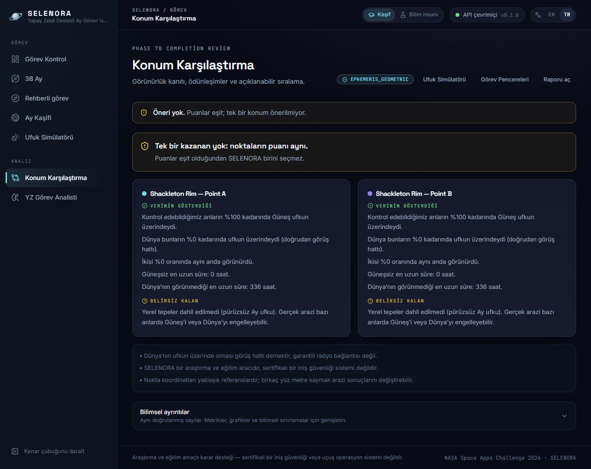
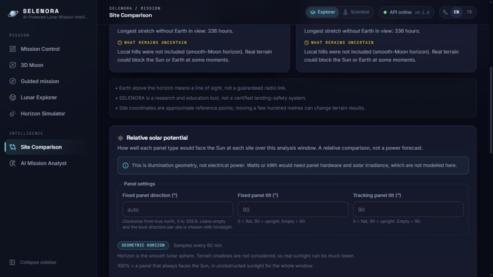
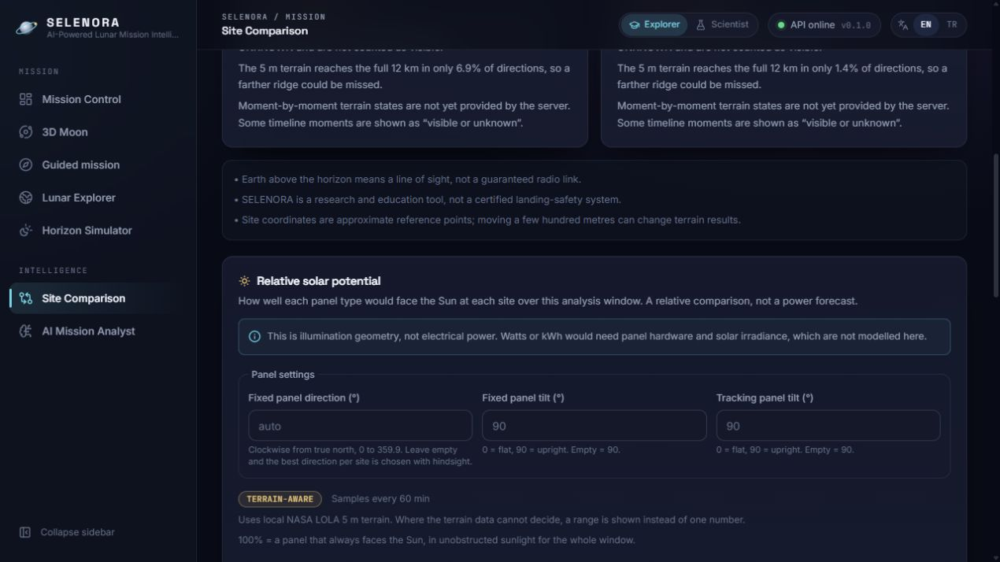
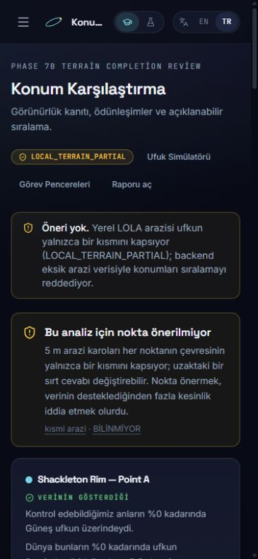

# SELENORA Phase 7B Completion Report

Date: 2026-11-15

Review branch: `feature/phase7b-completion-review`

Reviewed implementation: `44af9c78e5631a501f16404a578ea2694e1bd9bc`

## Completion decision

The Phase 7B scientific model and API contract are sound, but the original `44af9c7` commit is **not release-ready on its own**. Real-browser review reproduced two user-facing defects:

1. Explorer mode placed the Phase 7B result inside the collapsed scientific-details section, so the primary result looked absent.
2. Exact numerical differences of only 0.0075–0.0103 percentage points were presented as a site lead even though both values rounded to the same displayed percentage and the sampled model cannot support that distinction.

Both defects are fixed with focused regression tests on the isolated review branch. After the fixes, the review branch is release-ready for Phase 7B scope. No merge or push was performed.

## Git and worktree isolation

| Item | Verified value |
|---|---|
| Review worktree | `.worktrees/phase7b-review` |
| Review branch | `feature/phase7b-completion-review` |
| Exact base | `44af9c78e5631a501f16404a578ea2694e1bd9bc` |
| Scientific comparison fix | `9d7f036` |
| Explorer visibility fix | `875fcd5` |

The active Phase 7A release candidate and Phase 7C worktree were not modified.

Claude's original `.worktrees/phase7b` remains on `feature/phase7b-solar-potential` at `44af9c7`. It contains uncommitted edits in:

- `backend/app/science/solar_potential.py`
- `backend/app/services/solar_service.py`
- `backend/tests/test_phase7b_solar_potential.py`
- `frontend/src/pages/ComparisonPage.tsx`

Those edits independently begin addressing the same near-tie and panel-placement issues. They were inspected read-only, not copied, edited, committed, or integrated. This divergence must be resolved explicitly before any later integration; the two worktrees must not be merged by assuming the uncommitted patches are identical.

## Scientific review

### Relative index and energy claims

The implementation computes a dimensionless relative illumination index:

`sum(visibility_fraction * cos(incidence_angle) * sample_hold_hours) / full_window_hours`

The 100% reference is continuous unobstructed sunlight with a dual-axis panel always normal to the Sun. The API and UI consistently state that this is **not** electrical power, irradiance, watts, watt-hours, or kWh. Panel area, efficiency, temperature, degradation, battery behavior, electrical losses, and solar irradiance are intentionally outside the model.

### Panel geometry

- Azimuth is clockwise from true north; east is 90°.
- Tilt is measured from local vertical: 0° is flat/upward and 90° is upright.
- Horizontal, fixed, azimuth-tracking and dual-axis incidence calculations use independent local 3D vectors.
- Fixed-panel auto-azimuth is an analysis-window hindsight optimum and is labeled as such.
- Fixed orientation is unavailable at the exact pole because true north is undefined there.

Browser acceptance confirmed that fixed azimuth 90° with tilt 0° equals the horizontal-panel result, while the same azimuth with tilt 90° produces a different result. The UI correctly labels east and the 0°/90° convention.

### GEOMETRIC, TERRAIN and UNKNOWN

- GEOMETRIC results use the smooth-sphere horizon and never claim terrain correction.
- TERRAIN results remain separate and use local NASA LOLA 5 m terrain evidence.
- An UNKNOWN sample contributes nothing to the lower bound. It contributes only to the upper bound where known geometry cannot rule out sunlight.
- UNKNOWN time remains in the full-window denominator; no midpoint or fabricated point estimate is created.
- Overlapping ranges do not rank sites.
- All-UNKNOWN terrain input returns `UNAVAILABLE` / `NO_KNOWN_VISIBILITY`, null terrain index values and no ranking. GEOMETRIC context is retained separately.

The all-UNKNOWN behavior is deliberately more conservative than the design document's optional `[0, geometric upper]` presentation. It avoids implying usable terrain evidence where none exists and is covered by regression tests. This is a documented conservative deviation, not a fabricated-data fallback.

### Near-tie policy

The review adds a 0.5 percentage-point minimum separation for a user-facing site lead. A site's lower bound must exceed every other site's upper bound by more than this margin. Overlapping ranges, equal values and closer values are reported as `NOT_DISTINGUISHABLE`.

This margin is disclosed in the API limitations. It does not alter any per-site solar index or uncertainty bound; it changes only whether the evidence supports a comparative lead.

## Confirmed defects and fixes

### 1. Misleading near-tie leader

Before the fix, the real GEOMETRIC analysis returned:

- Fixed panels: both displayed as 66.9%, but one site was declared the leader (exact delta 0.0103 percentage points).
- Azimuth tracking: both displayed as 100.0%, but one site was declared the leader (exact delta 0.0075 percentage points).

The comparison engine now accepts an explicit scientific separation margin, the service applies 0.5 percentage points, and pure-function plus service-level regression tests cover a 100.0% versus 99.7% near tie.

### 2. Primary result hidden in Explorer mode

`SolarPotentialPanel` was rendered only inside the collapsed scientific-details block. The panel is now rendered directly after the plain-language Explorer summary. Scientist mode retains its existing placement in the full results flow. A regression test proves that the panel is visible while the scientific-details disclosure remains collapsed.

## Real-data browser acceptance

The isolated QA process served this review worktree only:

- Frontend: `http://127.0.0.1:5228`
- Backend: `http://127.0.0.1:8068`
- Backend health response: API `v0.1.0`, algorithm `0.3.1-phase3.3`
- Database: isolated temporary SQLite database, removed after QA

The package version shown by `/health` is not a Git provenance marker. Worktree path, process command, branch and commit were checked separately before testing.

Two analyses were generated from live NASA/JPL Horizons ephemerides and local NASA LOLA data:

| Scenario | Analysis ID | Model | Completion time |
|---|---|---|---:|
| Geometric | `bde6ea81-1d0a-4035-b685-057c209def55` | GEOMETRIC | 2.267 s |
| Terrain | `b20bd7a0-4370-4c82-bd20-79a60e925d6d` | LOCAL_TERRAIN_PARTIAL | 2.482 s |

Both covered 2026-12-01 through 2026-12-15 UTC at 60-minute resolution for two Shackleton-rim reference sites. Provenance displayed JPL Horizons v1.2 and LOLA PGDA 5 m.

Acceptance results:

- Explorer and Scientist modes: passed.
- English and Turkish: passed.
- Desktop and 375 px mobile: passed.
- Mobile measured `innerWidth=375`, document/body width 365 px, with no horizontal overflow.
- Browser console errors: 0.
- GEOMETRIC/TERRAIN labels and explanatory text: passed.
- Photo/electrical-energy disclaimer: passed; no electrical output claim is made.
- Fixed-panel orientation controls and debounce behavior: passed.
- Partial UNKNOWN bounds and refusal to rank overlapping ranges: passed.

For the terrain-aware dual-axis result:

| Site | Terrain lower–upper | Unknown fraction | Geometric context |
|---|---:|---:|---:|
| Shackleton Rim — Point A | 0.0%–32.4% | 33% | 100.0% |
| Shackleton Rim — Point B | 0.0%–52.3% | 53% | 100.0% |

The UI labels the geometric number as context only and does not convert either uncertainty interval into a recommendation.

## Screenshots

### Before: Phase 7B result hidden in collapsed Explorer details

### After: GEOMETRIC panel is a visible Explorer result

### After: TERRAIN panel preserves ranges and relative-only warning

### After: Turkish 375 px mobile layout

The additional baseline terrain and mobile captures are retained in `docs/screenshots/phase7b-completion/` for side-by-side audit.

## Quality gates

### Baseline at exact `44af9c7`

| Gate | Result |
|---|---|
| Backend pytest | 240 passed, 1 skipped, 3 deselected |
| Frontend Vitest | 206 passed in 28 files |
| TypeScript | Passed |
| Lint | Passed with pre-existing warnings, 0 errors |
| Production build | Passed; 4,073 modules |

### Review branch after fixes

| Gate | Result |
|---|---|
| Focused backend Phase 7B | 33 passed |
| Focused frontend | 18 passed |
| Full backend pytest | 240 passed, 1 skipped, 3 deselected in 18.14 s |
| Full frontend Vitest | 207 passed in 28 files in 8.82 s |
| TypeScript | Passed |
| Lint | Passed with pre-existing warnings, 0 errors |
| Production build | Passed; 4,073 modules in 1.01 s |

Vitest still reports repository-existing jsdom canvas and React `act(...)` warnings. Oxlint reports existing Fast Refresh/compiler warnings. None is a test failure or introduced error, and the Phase 7B focused files add no lint error.

## Changed files

- `backend/app/science/solar_potential.py`
- `backend/app/services/solar_service.py`
- `backend/tests/test_phase7b_solar_potential.py`
- `frontend/src/pages/ComparisonPage.tsx`
- `frontend/src/pages/ComparisonPage.test.tsx`
- `docs/PHASE7B_COMPLETION_REPORT.md`
- `docs/screenshots/phase7b-completion/*`

## Remaining limits

- The result is a relative illumination index, not an electrical energy model.
- Fixed auto-azimuth is optimized with hindsight over the selected analysis window.
- Hourly sample-and-hold cannot resolve changes shorter than the analysis step.
- Partial LOLA azimuth coverage creates genuine uncertainty ranges; it must not be cosmetically narrowed.
- Moment-by-moment terrain states are not available for every UI timeline sample, and the UI says so.
- The 0.5 percentage-point comparison margin is an explicit product/science policy and should remain versioned if later calibration changes it.

No Phase 7D/7E implementation was started. No large dataset was downloaded. No branch was merged or pushed.
