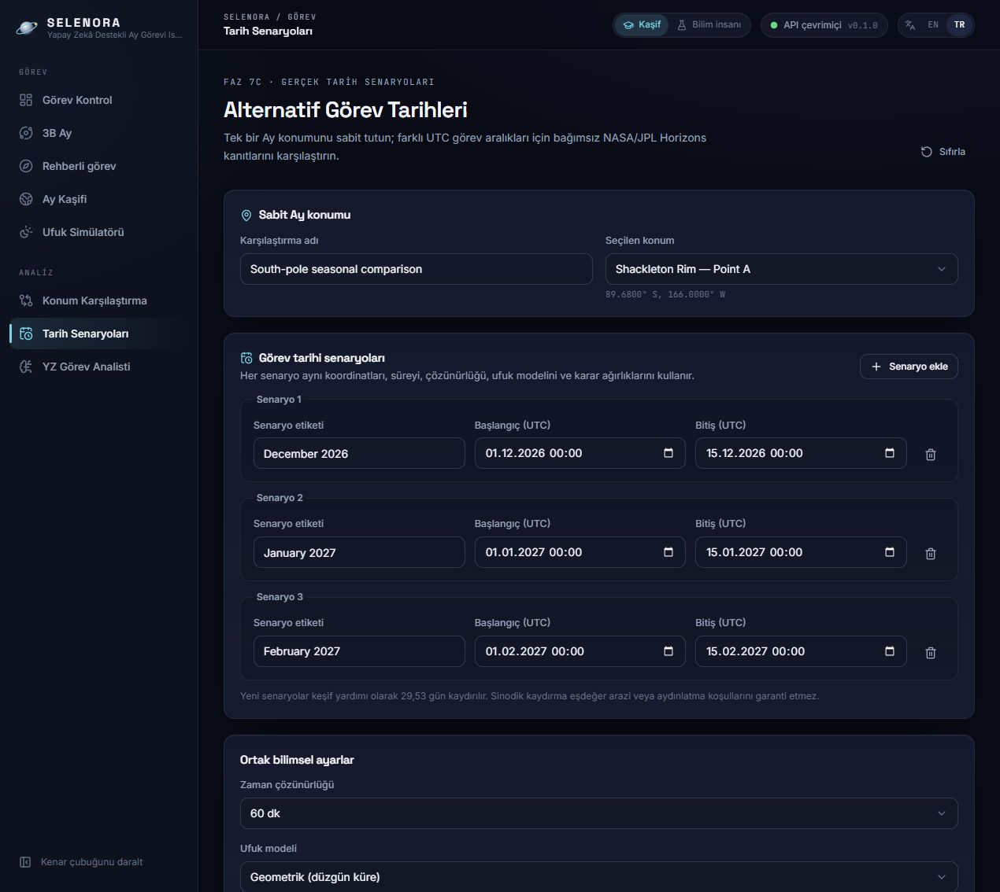
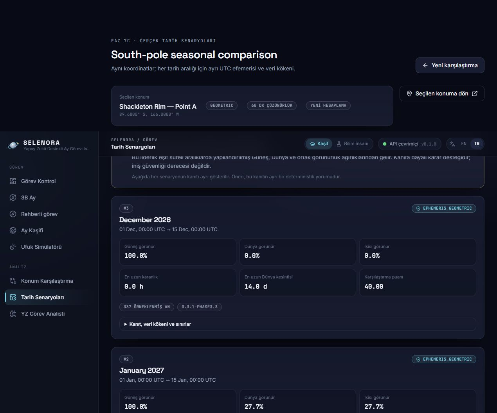
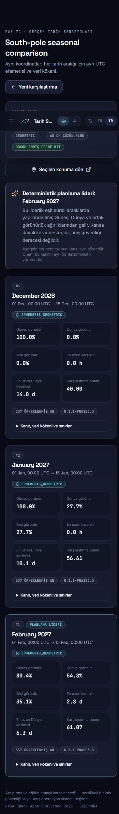

# SELENORA Phase 7C — Alternative Mission-Date Scenarios

## Delivery identity

- Base commit: `4e665ba41a28a4f3830adb132ed733d33c27848b`
- Branch: `feature/phase7c-date-scenarios`
- Isolated worktree: `.worktrees/phase7c`
- Scope: one stable lunar site compared across independent UTC mission-date windows.
- Existing `POST /api/v1/analyses` contract remains unchanged and still requires distinct sites.

## Implementation summary

Phase 7C adds a dedicated `POST /api/v1/scenarios` workflow rather than weakening the location-comparison contract. A request contains one stable reference or custom-site identity, two to ten UTC windows, one common sample interval, one horizon model, and one set of H2 decision weights. Each window obtains independent Sun and Earth ephemerides and retains its own data quality, evidence, limitations, provenance, score, and rank.

The workflow never substitutes synthetic visibility values. NASA/JPL Horizons or required terrain failures are stored as failed comparisons and returned as explicit API errors. UNKNOWN remains missing or incomplete knowledge and is never treated as darkness.

## Architecture

### Backend

- New `scenario_comparisons` table and additive Alembic migration persist request, state, stable site identity, result evidence, cache identity, errors, and timestamps.
- New endpoints:
  - `GET /api/v1/scenarios`
  - `POST /api/v1/scenarios`
  - `GET /api/v1/scenarios/{comparison_id}`
- The scenario service reuses the authoritative analysis pipeline after obtaining a fresh date-bounded Sun/Earth ephemeris pair for every scenario.
- Upstream concurrency remains bounded by the existing Horizons concurrency limit.
- The scientific cache key includes coordinates and stable site identity, every UTC range, time step, horizon model, H1 algorithm/data-source version, and H2 weights. A changed date or changed weight cannot reuse an incompatible result.
- Cross-scenario ranking is emitted only when every scenario is scientifically scorable. Partial terrain or ephemeris evidence suppresses the recommendation.

### Validation and reliability

- Two to ten scenarios.
- Unique IDs, labels, and date windows.
- Equal window duration for comparable results.
- UTC-aware timestamps, positive intervals, maximum 30 days per window.
- Common 10–1440 minute sample interval and a 30,000 total-sample cap.
- Horizons and terrain failures remain failures; no successful fictional payload is generated.
- Reference and custom sites preserve stable identity and exact coordinates.

### Frontend

- New routes: `/scenarios` and `/scenarios/:comparisonId`.
- A dedicated TR/EN planner supports reference/custom-site selection, two to ten date windows, UTC intervals, resolution, horizon mode, and H2 weights.
- Results separate per-window evidence from the deterministic planning interpretation, display data quality/provenance/limitations, expose cache status, warn about incomplete terrain, and return to the selected location.
- Planner and primary navigation provide an entry point without altering the existing location-comparison workflow.
- No synthetic demo fallback is offered.

## Changed files

### Backend and contract

- `backend/app/api/v1/scenarios.py`
- `backend/app/api/v1/__init__.py`
- `backend/app/schemas/scenarios.py`
- `backend/app/services/scenario_service.py`
- `backend/app/services/analysis_service.py`
- `backend/app/models/analysis.py`
- `backend/app/models/__init__.py`
- `backend/alembic/versions/20261115_0002_phase7c_scenarios.py`
- `backend/tests/test_phase7c_scenarios.py`
- `docs/API_CONTRACT.md`

### Frontend

- `frontend/src/pages/DateScenariosPage.tsx`
- `frontend/src/pages/DateScenariosPage.test.tsx`
- `frontend/src/features/date-scenarios/validation.ts`
- `frontend/src/features/date-scenarios/validation.test.ts`
- `frontend/src/app/router.tsx`
- `frontend/src/components/layout/navItems.ts`
- `frontend/src/pages/PlannerPage.tsx`
- `frontend/src/hooks/useApi.ts`
- `frontend/src/services/selenoraApi.ts`
- `frontend/src/types/api.ts`
- `frontend/src/i18n/locales/phase7c.en.ts`
- `frontend/src/i18n/locales/phase7c.tr.ts`
- `frontend/src/i18n/locales/en.ts`
- `frontend/src/i18n/locales/tr.ts`

## Scientific behavior verified

- The same Shackleton Rim Point A identity and coordinates (`-89.68°, -166.0°`) were retained for all windows.
- December 2026, January 2027, and February 2027 produced separate live JPL Horizons provenance timestamps and different evidence.
- Browser QA returned `EPHEMERIS_GEOMETRIC` with algorithm `0.3.1-phase3.3`; the results did not claim terrain blocking.
- H1 rules remain in the existing pipeline: separate valid denominators, null values for unknown-only evidence, and UNKNOWN excluded from darkness.
- H2 weights participate in cache identity and deterministic score calculation.
- A mocked partial-terrain regression verifies that incomplete evidence suppresses cross-scenario recommendation.

## Real browser QA

Isolated processes served this worktree only:

- Frontend: `http://127.0.0.1:5227`
- Backend: `http://127.0.0.1:8067`
- OpenAPI was checked for `/api/v1/scenarios` before testing.
- The QA database, ports, and temporary LOLA test junction were removed after validation.

Live browser observations:

- Turkish planner opened with one stable site and three equal-duration date windows.
- The first comparison used live NASA/JPL Horizons provenance version `1.2`.
- December/January/February evidence differed while site identity remained unchanged.
- Exact repeated request returned the same persisted comparison as a verified cache hit.
- TR and EN result views rendered correctly.
- The selected-site return link navigated to `/explorer?site=shackleton-rim-a`.
- At 375 px, document width was 365 px inside a 375 px viewport; no horizontal overflow occurred.
- Browser console errors: 0.

### Measurements

| Flow | Measured browser time |
| --- | ---: |
| First live JPL comparison, three 14-day hourly windows | 2.328 s |
| Exact repeated request, cache hit | 0.262 s |

Times are local QA observations on 2026-11-15 and include UI request/navigation overhead. Remote service latency can vary.

### Screenshots

Planner, desktop result, and 375 px mobile result:

## Automated verification

- Backend full non-live suite: 220 passed, 1 skipped, 3 live tests deselected by the repository default marker policy.
- Phase 7C backend regressions: 13 passed.
- Frontend full Vitest suite: 29 files, 198 tests passed.
- Phase 7C focused frontend tests: 5 passed.
- TypeScript project check: passed.
- Production build: passed (4,071 modules transformed).
- Lint: passed with pre-existing repository warnings and no errors.
- `git diff --check`: passed.

Backend coverage includes same-site/different-date independence, exact-range provenance, exact-request cache hit, changed-date and changed-weight isolation, validation limits, custom-site identity, missing ephemeris without fabrication, partial terrain UNKNOWN, upstream API failure, and preservation of the distinct-site `/analyses` contract.

## Persistence and integration dependencies

- Deployments must apply Alembic revision `20261115_0002`.
- Production scenario execution requires outbound NASA/JPL Horizons access.
- TERRAIN scenario execution additionally requires the existing validated local LOLA coverage; uncovered or incomplete terrain remains explicit UNKNOWN/partial evidence.
- The UI relies on the existing landing-site catalog and mission-store custom sites; no new site-coordinate convention was introduced.
- Other feature branches should integrate the migration, router/nav additions, locale spreads, API types/hooks, and scenario service together.

## Remaining limits and follow-up recommendations

- The group cache intentionally reuses exact complete requests. A future phase may add a lower-level per-window ephemeris cache for scientifically identical windows embedded in differently named comparisons, with explicit provenance and invalidation rules.
- Long or high-frequency multi-window requests remain bounded but can still take longer when JPL is slow; the UI shows an active request and returns explicit failure instead of fallback data.
- Terrain comparisons are only as complete as validated local LOLA coverage. Phase 7C does not infer terrain visibility outside that coverage.
- This phase does not implement Phase 7D, NAC 1 m, ShadowCam, or changes to scientific coordinate conventions.

## Delivery boundary

Changes are committed only to `feature/phase7c-date-scenarios`. Nothing was merged or pushed, and Cursor/Claude worktrees were not modified.
